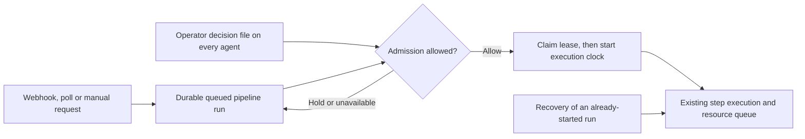

# Pipelines

**Audience:** owners and developers connecting a repository's checks, and operators running the cluster they run on.
**Design:** `docs/superpowers/specs/2026-09-16-pipelines-program-design.md`, decisions D1-D16 and its implementation notes for epic memql#5477.

A pipeline is a repository's checks: declared in the `pipeline:` block of the
repository's `memql-package.yaml`, delivered by the cluster's GitHub App, run by
the cluster as a work goal, and reported back to GitHub as a check run on the
commit it checked. By default, pull requests select affected coverage; merge
queue, default-branch push and published-release events select full coverage
for their applicable stages. An installed policy can select component-specific
stages and explicitly reuse eligible verification evidence. Artifact preparation
and publication still require their own recorded effects.

> **What runs today.** This release takes deliveries, opens and deduplicates
> runs, plans them, executes their steps and reports them on GitHub. A step
> runs as a Kubernetes Job on the cluster, or on one of the owner's own machines
> when it names a need: [the pipelines substrate](pipelines-substrate.md) is
> that half, and what an operator sets up before the first run. Read
> [What runs today](#what-runs-today) before you make the check required.

Pipelines manages repository delivery in MemQL OS. Each configured source
(`v1:platform:package`) has at most one, owned by the source's owner, and every
GitHub token a run uses is minted through that owner's GitHub connection. It is
not the order a deploy runs in, which [Packages](packages.md#the-order-and-why-it-never-changes)
also calls a pipeline: a pipeline here checks commits, and never starts a
deploy by itself.

**A repository has one pipeline.** Two would write two check runs of the same
name on every commit, so connecting a repository that another source's pipeline
already runs is refused `pipeline_already_connected`. To move a repository's
checks to another source, disconnect the pipeline it has first
([Connecting a pipeline](#connecting-a-pipeline)).

| Row | One per | What it holds |
|---|---|---|
| `v1:pipelines:pipeline` | source | The repository, how deliveries arrive, where steps may run, which secrets they may resolve, what the poll has seen, the timing table. Never the manifest: every run reads that at its own commit |
| `v1:pipelines:run` | attempt of one run key | The event and mode, status and conclusion, the refusal that ended it, the check run's id and state, the stage table, the agent driving it |
| `v1:pipelines:channel` | notify target | Where a notify stage delivers; managed in Pipelines → Settings → Channels |

A run compiles into one `v1:work:goal` with one `v1:work:step` per step, so the
work spine's journal and the Nexus drawing show it like any other work. Every
row is readable by its owner, by a cluster owner, and by members of the account
its source belongs to -- exactly the people who read the source. None holds a
token, a secret value or a log line.

---

## Repository maintenance

Owners and developers can request a scoped change through Ask or a repository's
request form. The installation's `MEMQL_REPOSITORY_AUTHORITY_RESOLVER` selects
the maintainer source or request-only peer from operator bindings. Source
visibility and a local owner role do not grant upstream write permission.
Requests to another maintainer wait for that maintainer's recorded decision;
requests under the caller's own current provider write authority may start
immediately. The request records its repository's stable identity, allowed
paths, expiry, goal and execution. Related requests retain parent links, which
carry no additional authority.

The native proposal boundary accepts one immutable set of file replacements
against an exact base commit. A `propose_change` request authorizes a draft pull
request only. `deliver_change` additionally authorizes independent review and
merge-queue admission; it is available only when the installed authority route
declares both a review prompt and a queue-only delivery recipe. An existing
draft request cannot be upgraded by retrying it with a different operation.

The change recipe, independent review prompt with its partials, and delivery
recipe are captured before approval. Changing their content or routing
invalidates the delegation. The native reviewer receives the immutable source
and exact proposed replacements; a caller-supplied approval cannot substitute
for its recorded verdict. Delivery refuses any proposal that differs from the
approved review. Every effect rechecks the maintainer's current decision,
provider write permission, recipe and execution authority.

Queue admission verifies the same PR and reviewed head, required successful
GitHub checks, current default branch and applicable review rules. It may mark
a reviewed draft ready so GitHub can request required reviews. CODEOWNER and
other required approvals still block queue admission until satisfied; no admin
bypass or direct merge occurs. Pending checks and uncertain provider responses
retain the same durable delivery. A bounded scheduled recovery leases that
record across replicas and runs only its captured queue recipe. Recovery may
continue after the original run succeeds while its goal stays open; closing or
cancelling the goal, revoking approval, or changing the reviewed head prevents
further admission. `queued` records provider-confirmed admission, not a merge.
After admission, recovery only observes the same PR: it records a confirmed
merge or surfaces removal from the queue without automatically re-enqueueing.
An outage retains that observation-only state and reports the uncertainty.
Release publication and installation require their separate authorization.

Status and request-list reads retain the statement, requested operation,
decision, review and delivery response across reconnects and replicas. A local
maintainer receives links to their own goal and approval. Other requesters,
including remote installations, receive the request's status without private
upstream goal or approval identifiers.

A `repositoryChange` step applies a retained JSON proposal through the pipeline
source's current GitHub App grant. The command that generates the proposal
receives no writer token. This supports dependency tidy commits and draft
upgrade proposals while keeping file and branch authority in operator settings.

Enable this optional writer only when the source's installed GitHub App grants
**Contents: Read and write** and **Pull requests: Read and write**. The default
App setup now requests these permissions for governed delivery, along with
merge-queue writes, commit-status reads and read-only administration access to
observe classic branch protection. It never requests administration writes or
workflow-file writes. An existing App needs its permissions updated and the
installation owner must accept the change before a proposal or queue admission
can proceed. Build and proposal commands still receive only an explicitly
requested read token. The native writer checks the current source owner's
authority; an installed App's broader grant does not replace that check.

```yaml
- name: prepare
  on: [schedule, manual]
  steps:
    - name: upgrade
      run: python3 scripts/ci/repository-proposal.py engine-watch --output=.reports/engine-proposal.json
      artifacts: [.reports/engine-proposal.json]
- name: propose
  on: [schedule, manual]
  steps:
    - name: upgrade
      repositoryChange:
        rule: engine-upgrade
        step: prepare.upgrade
        path: .reports/engine-proposal.json
      timeout: 5m
```

The operator stores `MEMQL_PIPELINES_REPOSITORY_CHANGE_RULES` as a system
variable. Its JSON has `schema: 1` and a `rules` list. Each rule names a
`name`, exact `repository` (`owner/repo`), `mode`, `branchPrefix` ending in
`/`, and explicit `paths`. There are no wildcard grants. For example:

```json
{
  "schema": 1,
  "rules": [{
    "name": "engine-upgrade",
    "repository": "example/product",
    "mode": "propose",
    "branchPrefix": "engine-bump/",
    "paths": ["product.env"]
  }]
}
```

`propose` accepts only scheduled or owner-requested runs of the current default
branch. It creates a draft pull request and never merges it. An existing branch
is reconciled only when it identifies the exact prepared commit; a moved branch
or a deliberately closed proposal is not overwritten or reopened.

`update` also requires `author` and `actor`, such as `dependabot[bot]`. It accepts
only a same-repository pull request whose original signed webhook has that
actor, whose current author matches, and whose complete changed-file inventory
fits the rule. Poll-only runs lack this signed actor evidence and cannot update
a pull request. An owner retry retains the original delivery identity. Both
modes recheck the rule, source binding and grant immediately before writing.

The proposal contains `schema: 1`, the exact source `commit`, a short `key`,
`title`, `body`, and `files`. Each file has `path`, `baseSha256`, and UTF-8
`content`. An empty base digest requires an absent file. The limit is 4 MiB
for the proposal, 1 MiB per file and 256 files. Existing regular files retain
their Git mode, including executable files (`100755`); new files use `100644`.
The bounded branch writer supports content replacement, not mode changes.
Deletion, symlinks and workflow changes are not supported. An empty file list records
`unchanged` and mints no writer token.

The driver validates the producer's successful journal, object version, size
and SHA-256 before parsing the proposal. It pins the artifact while an external
write is unresolved. Branch writes use deterministic commits with the exact
source parent, refuse force pushes, and require read-back. A replica recovering
a lost response observes the same commit instead of repeating the branch write.
An unresolved write fails the step and retains its evidence for reconciliation.

## Connecting a pipeline

**Who:** the source's owner, holding `execute` on `app:pipelines/connect`.
**How:** in MemQL OS, open **Pipelines → Repositories**, select the repository,
and choose **Connect pipeline**
([below](#in-memql-os)); or the `pipelinesConnect` builtin.

Before connecting:

1. **The cluster has a GitHub App that holds checks write.** See
   [GitHub Connect](github-connect.md#creating-the-github-app); an app
   registered before pipelines needs
   [the upgrade](github-connect.md#upgrading-an-app-registered-before-pipelines).
   Webhook delivery also needs the app's webhook on and subscribed to the five
   events that page lists.
2. **The source is a GitHub repository fetched through your GitHub
   connection**, not a pasted token. A pipeline acts through the app's
   installation, which a pasted token does not have: switch the source to the
   connection first.
3. **`memql-package.yaml` at the default branch's head has a `pipeline:` block
   that validates** ([the block](#the-pipeline-block)).

Then:

```
builtin pipelinesConnect(packageId: "<package id>", delivery: "webhook")
```

or from an SDK: `pipelinesConnect({ packageId, delivery })` on the TS
`QueryClient`, `PipelinesConnect` in `sdk/go/client`.

| Argument | Values | Meaning |
|---|---|---|
| `packageId` | required | The source to connect. It must be yours |
| `delivery` | `webhook` or `poll`, required | How changes reach the pipeline ([Delivery](#delivery-webhook-or-poll)) |
| `compute` | `cluster`, the default, or `cluster_and_fleet` | Where steps may run ([Compute](#compute)) |
| `secretNames` | a list of names | The secrets steps may resolve: the owner's allowlist ([Secrets](#secrets)). A name beginning `MEMQL_` is refused |

Before any request leaves the cluster, connect refuses a repository another
source's pipeline already runs, `pipeline_already_connected`: a repository has
one pipeline, so its checks are reported once per commit. The remedy is to
disconnect the other source's pipeline -- its owner does, with
`pipelinesDisconnect`, or a cluster owner does when that owner has left -- or to
work from that source. The refusal says that such a pipeline exists and nothing
about whose it is; a disconnected pipeline blocks nothing.

Connect then proves the source's connection still reaches the repository by
minting an installation token through it, reads the default branch's head and
the manifest there, and validates the block. A source with no block is refused
`pipeline_not_declared`, and a block that does not validate is refused with its
own code ([Refusal codes](#refusal-codes)), so a block that can never compile is
never connected; a manifest that does not parse at all is refused
`package_manifest_invalid`, as it is for a deploy. Connect also asks what this
connection allows of every step, whatever event would plan it: a step naming a
need on a `cluster` pipeline, or a secret `secretNames` does not hold, is
refused with its own code now rather than on the first push that reaches it,
and every run asks again of the stages it runs ([Secrets](#secrets),
[Compute](#compute)). The connection's own failures are the ones a fetch gives
-- `credential_not_found` (the source fetches under a pasted token, or names no
connection), `credential_revoked`, `reconnect_required`,
`repository_not_installed`, `installation_pending`,
`github_app_not_configured` -- as
[GitHub Connect](github-connect.md#what-a-person-sees) describes them.

It answers `{pipelineId, repository, delivery, compute, stages}`, the stages
being the block's stage names in order. **Connecting runs nothing:** the first
run comes with the next push or pull request.

Afterwards:

- **Reconnect** with the same call. The pipeline keeps its id; the call restates
  delivery, compute and the allowed secret names and reactivates a
  disconnected pipeline, while what the poll has seen and the timing table
  carry over. Pass the whole configuration each time. Reconnecting is refused
  `pipeline_already_connected` when another source's pipeline has taken the
  repository meanwhile, as any second pipeline is. Reconnect, too, after
  reinstalling the GitHub App on the repository or renaming the repository:
  deliveries are matched on the installation and the repository name a
  pipeline was connected with ([Delivery](#delivery-webhook-or-poll)).
- **Disconnect** with `builtin pipelinesDisconnect(pipelineId: "<pipeline id>")`
  (`execute` on `app:pipelines/connect`). It opens no more runs, and a run no
  agent has started yet concludes `pipeline_disconnected`. The pipeline and its
  runs stay, as the history, and the repository is free for another source's
  pipeline.
- **Re-run** with `builtin pipelinesRerun(runId: "<run id>")` (`execute` on
  `app:pipelines/rerun`): the next attempt of the run's key, in the
  original's mode and event, with a new check run. The original stays as it
  ended.
- **Re-run failed** with `builtin pipelinesRerun(runId: "<run id>", failedOnly:
  true)`: the same new attempt, running only what the original did not pass.
  Every step the original passed **with the same package slice** is carried
  over as skipped `pipeline_passed_earlier` (*Passed in attempt 1.*), and
  everything else runs. A shard whose slice moved since -- the timing table
  learned between the attempts -- runs again, because a pass over other
  packages is not a pass of these. A notify stage is never carried: it
  announces the new attempt, which has an outcome of its own. A run with no
  failed or cancelled step (one that passed, or one refused before any step) is
  refused `pipeline_nothing_to_rerun`. GitHub's own re-request stays a whole
  re-run: one check run reports the whole run.
- **Cancel** with `builtin pipelinesCancel(runId: "<run id>")` (`execute` on
  `app:pipelines/cancel`). It flags the run; the agent driving it cancels
  what is executing at its next heartbeat and concludes the run cancelled. A
  queued run no agent has claimed is concluded cancelled at once. A new push
  to a pull request cancels the pull request's earlier runs the same way
  ([Cancel-on-push](pipelines-substrate.md#cancel-on-push)).

Each acts on your own pipeline or run only. A caller who does not own it is
refused by name before anything is written. The one exception is disconnect: a
cluster owner may disconnect any pipeline, so an operator can free a repository
whose pipeline belongs to somebody who has left. It writes the pipeline's
status and nothing else.

**Preview** with `builtin pipelinesPreview(packageId: "<package id>")`
(`execute` on `app:pipelines/connect`) to read what connecting would act on,
writing nothing: the same read connect makes -- the grant proved by a mint, the
default branch's head and the block there, validated -- answered as the stages
and steps (their shape, never a command), the needs and secrets they name, the
check's name, the source's existing pipeline for a reconnect, and a delivery
suggestion (webhook where GitHub can plausibly reach the cluster, poll
otherwise). A typed refusal is the answer's `refusal`, not an error.

## In MemQL OS

The **Pipelines** app owns **Overview**, **Repositories**, **Changes**,
**Runs**, **Releases**, **Logs** and **Settings**. Deployables shows source
context and links to Pipelines; it manages deployed applications. Cluster
**Updates** owns this installation’s selected release. Preparing a plan never
applies it. If preparation is interrupted, **Resume preparation** continues the
saved request after a reload. Before applying, its original operator can choose
**Choose a different release** and confirm cancellation to release that plan.
Once application has started, cancellation is unavailable; progress reads keep
checking the same installation attempt. A repository or proposal outage is shown
separately; saved preparation, plan cancellation and installation progress stay
available under the original native permission checks.

**Add repository** uses a left-step wizard: GitHub account, repository, MemQL
organization, then review. Repository details use local tabs for **Details**,
**Change requests**, **Checks**, **Deployables** and **Settings**. Change
requests read fresh repository authority; being an owner or developer of this
installation does not grant write access to an upstream repository. Requests
name the intended change and allowed repository paths. The local maintainer
can open their Nexus goal or approval; other requesters see the saved request
and response. Draft-only work never grants queue permission. Delivery requests
use the separately declared review and queue gates; neither option grants
release publication or installation authority.

- **The repository’s Checks tab** shows the newest run on each branch, the default branch first,
  each opening its run. Its facts gain a **Pipeline** line (the manifest, how
  many stages the newest run planned, how changes arrive, where steps run), and
  **Latest upstream** says what that commit's checks said -- *checks passed,
  not yet deployed* among them. The bar reads *checks on* and carries **Pipeline
  settings**, or **Connect pipeline** for a source that has none. A connected pipeline offers **Run**, which asks for a branch and defaults to
  the default branch. A disconnected pipeline offers **Run latest**, which
  runs the default branch, or **Other branch**, which asks for the branch under
  the facts: a list of the repository's other branches when the source's grant
  can read them, a text field when it cannot. Either is `pipelinesRunLatest`,
  whose optional `branch` names the branch (empty is the default branch); a
  name GitHub would not accept is refused `pipeline_branch_invalid` before any
  request leaves the cluster. MemQL reads the branch through that source's
  installation grant and pins the returned commit SHA. Automatic delivery stays
  as configured; the manual event has its own deduplication key. Only
  stages with no `on` selector or with `on: [manual]` run; publication stages
  should name their intended events explicitly. A manual run writes the
  pipeline's separate `/ manual` check on its commit, so a branch's run
  shows on that commit and on the pull request whose head it is. Repeating the
  request for the same head returns the same run, whichever branch reached it;
  use **Re-run** after it finishes to create another attempt. A
  source that produces no apps and runs a pipeline -- the engine repository is
  one -- reads *pipeline* where its app count goes in the Repositories list, and the
  Overview map draws a **Checks** node beside the deployables a checked source
  serves.
- **Connect pipeline** uses the same left-step wizard pattern as Fleet setup,
  with three steps. **Repository** reads `memql-package.yaml` at the default
  branch's head with `pipelinesPreview`, so the stages show before anything is
  confirmed. **Compute** offers *Cluster* and, only when one of your machines
  reports `pipelines=allowed`, *Cluster and your fleet* -- the fleet alone
  when a step names a need, which the cluster refuses -- and waits for a
  choice, because running steps on your own machines is consent. **Confirm**
  names the check, the stages and the secrets the steps read, and asks how
  changes arrive. A refusal lands at the stop it is about, with its remedy: a
  fleet code at Compute, a secret code at Confirm, everything else at
  Repository. Nothing is written until Connect, and leaving keeps the answers.
- **Runs** is a Pipelines section (`read app:pipelines/runs`):
  every run of every source you connected, newest first, grouped by day,
  Refine for the source, branch and outcome. A run rings once, when it has an
  answer.
- **A run’s page** draws the stages down the left, or across a narrow window,
  read from the step rows; the open stop's steps say where each ran and for how long; a failed
  step shows its last lines -- read from its full log, which the runner keeps in
  your Library -- with **Open the full log**; a skipped step says why; the
  artifacts open in Files. One bar carries the state and the acts the run
  allows: **Open on GitHub**, **Re-run**, **Re-run failed**, or **Cancel** while
  it runs. The check run's details link, `https://os.<domain>/?pipelineRun=<run
  id>`, opens it.
- **Pipelines → Settings → Infrastructure** (`read app:settings/pipelines`,
  the cluster owner) holds the [readiness](#readiness) report. Connections and
  notification channels are under **Settings → Connections**.

---

## The `pipeline:` block

The block sits beside `deployables:` in [the manifest](packages.md#the-manifest);
a repository with checks and no apps declares it alone. An example -- the
pipeline the design record sketches for MemQL's own repository:

```yaml
formatVersion: 1
name: memql
pipeline:
  image: ghcr.io/znasllc-io/memql-toolchain@sha256:...
  services:
    postgres:
      image: ghcr.io/znasllc-io/timescaledb-pgvector@sha256:...
      env:
        POSTGRES_PASSWORD: postgres
      ready: pg_isready -U postgres
  caches: [go, npm]
  select:
    go: import-graph
    dbGated: [component/memql, component/database]
    buckets:
      gates: ["**"]
      os:    ["clients/**", "sdk/ts/**", "brand/**"]
  stages:
    - name: checks
      steps:
        - name: build-vet
          run: go build ./... && go vet ./...
    - name: tests
      needs: [checks]
      steps:
        - name: go-tests
          run: go test $MEMQL_PACKAGES
          packages: affected
          shards: 4
        - name: db-tests
          run: MEMQL_REQUIRE_DB=1 go test $MEMQL_PACKAGES
          packages: affected
          only: db-gated
          services: [postgres]
          shards: 4
        - name: os-checks
          run: make os-typecheck os-test os-build
          when: { bucket: os }
        - name: source-contracts
          run: go test -count=1 ./ ./integrations
          when: { bucket: gates }
    - name: deploy
      on: [push]
      steps:
        - name: verify-rollout
          run: ./scripts/verify-rollout.sh --target=https://api.<domain> --version="$MEMQL_VERSION"
          secrets: [VERIFY_TOKEN]
    - name: notify
      on: [push]
      channel: znas-instance
```

Connected with `secretNames: [VERIFY_TOKEN]`, it runs `checks` and then `tests`
on every run, and `deploy` and `notify` only on a push to the default branch.
`dbGated` is what `only: db-gated` reads, and the block is refused without it;
the sidecar's `env` and `ready` are what a Postgres image needs to start and to
be waited on.

**Two checks, at two times.** The block is read by the manifest's one strict
decoder, so a misspelled key anywhere inside it -- `shardz:`, `cachez:` --
refuses the whole manifest with `package_manifest_invalid`, the deploy as well
as the run, exactly as `deployabels:` does. What the block *means* -- a need
nobody offers, a bucket nobody declared, a timeout that is not a duration -- is
checked when a run compiles, and fails only that run, with a `pipeline_*` code:
a mistake of meaning never refuses a deploy of the source it sits in.

The meaning is checked at connect, against the default branch's head, and again
on every run, against the run's own commit, because a pull request can change
its own pipeline. A run reads the whole block, including stages it will not
execute -- a typo in the deploy stage fails the pull request that makes it, not
the push after it lands -- and reports the first problem in a fixed order: the
services, the `select` block, then each stage and its steps as written. What
depends on the pipeline's own settings, an allowed secret or consent to the
fleet, is asked only of the stages the run executes.

### Names

Every name the block declares -- a stage, a step, a service, a bucket, a
channel -- is lower-case letters, digits and hyphens, starts with a letter or a
digit, and is at most 40 characters. A name is part of a step's key and of a
refusal's scope, so it never holds a dot, a slash or a hash.

### The block's keys

| Key | Value | Default | Refused when |
|---|---|---|---|
| `workflow` | Optional assertion of the operator-bound workflow name | Operator-bound workflow | A different name cannot override the installation binding; execution refuses it |
| `platform` | Default container platform (`linux/amd64` or `linux/arm64`); a step may override it | either Linux architecture on the cluster | Unknown OS/architecture: `pipeline_step_invalid` |
| `image` | The toolchain image container steps run in. Pin it by digest | none | -- |
| `services` | Named sidecars a step may ask for, each with `image` (required), `env` (plain `NAME: value` configuration, never a secret) and `ready` (a shell probe the runner waits on before the step's command starts) | none | A name that breaks the rule, a service with no image, or an `env` name that is not upper-case letters, digits and underscores starting with a letter or underscore: `pipeline_step_invalid`, scoped `services` or `services/<name>` |
| `caches` | Default caches inherited by steps, such as `go` and `npm` | none | -- |
| `select` | How steps choose what to run. Required once a step names `packages` | none | [Below](#select) |
| `stages` | The stages, in the order they run. At least one | required | Absent or empty: `pipeline_stage_invalid` |

The operator chooses installed delivery policy with
`MEMQL_PIPELINES_POLICY_RESOLVER`. The named pure template receives `repository`,
`ownerUserId` and `pipelineId`. It returns `{}` for portable defaults, or a complete
object of installed template names for these roles:

| Role | Purpose |
|---|---|
| `workflow` | Stage order, bounded parallel work and failure blocking |
| `stageIncluded` | Event, component and schedule selection |
| `packageSelection`, `packageStepSelection`, `bucketIncluded` | Affected package coverage |
| `eventMode`, `versionForEvent` | Event admission, coverage mode and artifact version |
| `notificationCopy`, `notificationOutcome` | Notification text and settlement |
| `artifactRetention` | Retention decisions |

Optional roles are `supersession`, `reconciliation`, `maintenance` and
`evidenceReuse`. Their default behavior preserves affected-PR supersession,
cancels an invalidated queue ref, and performs no repair or evidence reuse.
A resolver cannot change merge-group coverage mode away from `full` or grant
repository write access.
Source manifests declare commands and artifacts; they cannot replace this binding.

Every new run saves the complete reachable policy source and its fingerprint
before creating its GitHub check. Redelivery, retry and recovery use that saved
closure, including on another replica with a newer installed bundle. Selection
has no native effects. The stage selector additionally receives `stage`,
`repository`, `sha` and the original `releaseTag`, so independently versioned
components can share a checkout without sharing their publication tags.
Native code retains leases, current authority, immutable receipts and the final
verdict. See [Pipeline workflows](../build/integration-boundary.md#pipeline-workflows).

### Reusing verification evidence

A command may explicitly declare `verification: true` when its inputs completely
determine the check. Such steps must use digest-pinned cluster containers and
services, and cannot request secrets, repository tokens, artifacts or native
fleet execution. Run-, event- and version-dependent environment variables are
removed. The declaration is an author assertion: network-dependent or otherwise
nondeterministic commands should not use it.

The installed `evidenceReuse` selector can admit a successful full run's directly
completed receipt at the same commit, owner, source, engine revision, policy
fingerprint, command definition and package slice. Evidence older than 24 hours
is refused. Scheduled scans and explicit retries always execute. Artifact
production and publication always retain their own receipts; a reused test does
not stand in for either. Equal trees with different commit hashes are currently
checked separately.

### Recovery and maintenance

Recovery reads GitHub's current queue ref before cancelling work whose merge
group disappeared or moved. An unavailable provider response leaves it running.
Supersession cannot cancel unrelated full runs or releases.

After a failed run, the frozen `maintenance` policy returns `none`, `human`, or
`analysis` with an installed diagnosis template and an explanation. Analysis
opens one durable owner-scoped goal keyed to the failed run; a lost response or
another replica resumes that same request. Failed retries escalate to a person.
Analysis receives facts and ordinary Work authority, never a repository writer
or installation permission. Its state, explanation and linked goal are recorded
on the pipeline run. Installation of a verified release remains a separate,
explicit selection.

`image` and `caches` are passed to the runner as written; what each cache name
mounts is the runner's ([Caches](pipelines-substrate.md#caches)): it knows
`go` and `npm`, and a step declaring any other fails `pipeline_job_rejected`.

### Scheduled scans

Set `pipeline.schedule` to `daily` or `weekly` and opt each audit stage in with
`on: [schedule]`. A stage may override the pipeline cadence with its own
`schedule`. Other declared events remain independent: a weekly audit can also
run on a release or a manual qualification.

The daily scheduler uses UTC. A weekly period starts Monday; if Monday is
missed, the next invocation catches up. The first weekly opening pins that
week's commit, and later main pushes do not repeat it. A failed weekly scan
remains visible until explicitly rerun; its retry keeps the same commit and
period. Daily and weekly checks have `/ daily` and `/ weekly` suffixes, so they
cannot satisfy the required PR or merge-queue check.

### `select`

| Key | Value | Refused when |
|---|---|---|
| `go` | `import-graph`, the one Go selection there is | Any other value: `pipeline_select_invalid`. Absent while a step names `packages`: `pipeline_select_missing` |
| `dbGated` | Repository directories whose Go packages need a database, such as `component/memql`. `.` is the root package alone | An entry that is empty, absolute, holds `..` or a glob character, or names a directory starting with `.` or `_`: `pipeline_select_invalid` |
| `full` | Globs whose change selects every package, beside the built-in ones ([Which packages a step tests](#which-packages-a-step-tests)) | A glob that cannot be read, or a list of only `!` globs: `pipeline_select_invalid` |
| `buckets` | Named lists of globs a step gates on with `when: { bucket: <name> }` | A name that breaks the rule, an empty list, a glob that cannot be read, or a list of only `!` globs: `pipeline_select_invalid` |

### A stage's keys

| Key | Value | Refused when |
|---|---|---|
| `name` | The stage's name | Missing, breaking the rule, or used twice: `pipeline_stage_invalid` |
| `needs` | Earlier stages this one depends on. Recorded rather than scheduled on: stages run in the order written whatever it says | A stage that comes later, the stage itself, or no stage at all: `pipeline_stage_invalid` |
| `schedule` | Override the pipeline cadence with `daily` or `weekly` | Requires a pipeline schedule and `on: [schedule]`; otherwise `pipeline_stage_invalid` |
| `on` | The events (`pull_request`, `merge_group`, `push`, `release`, `schedule`, `manual`) and modes (`affected`, `full`) the stage runs for. Absent means every non-scheduled run, including a manual rehearsal | Anything else: `pipeline_event_unknown` |
| `runAfterFailure` | Boolean, default `false`. Run this stage even when an earlier stage failed; useful for independent security analysis. Does not erase failures or bypass cancellation | Non-boolean values fail manifest parsing |
| `steps` | The stage's steps, which run at once | Both `steps` and `channel`, or neither: `pipeline_stage_invalid` |
| `channel` | Makes the stage a notify stage naming a channel. It carries no steps, and compiles to one step, `<stage>.notify` | A name that breaks the rule: `pipeline_stage_invalid` |

### A step's keys

| Key | Value | Default | Refused when |
|---|---|---|---|
| `name` | The step's name, unique in its stage | required | Missing, breaking the rule, or used twice in the stage: `pipeline_step_invalid` |
| `execution` | `container` or `native`; native uses the host toolchain and ignores the pipeline image | `container` | Native steps with services or shared caches: `pipeline_step_invalid` |
| `githubReadToken` | Give a command `MEMQL_GITHUB_READ_TOKEN`, or an image build the BuildKit secret `github_read_token`, for this repository only | false | Cluster container commands and image builds with an installed source repository. Fixed permissions: contents, checks and pull requests read. It cannot write or reach other installation repositories; queued grants refresh before admission and logs redact them |
| `checkoutHistory` | Set `full` to fetch complete commit ancestry, tags and the comparison base during the trusted checkout | shallow | Cluster container steps only. The command receives history without the installation token; it should scan that local history without fetching again. The existing run deadline and workspace limits bound checkout |
| `memoryMiB` | Explicit memory request and limit for the cluster command container, in MiB; zero keeps namespace defaults | `0` | Nonzero values below 128, above 1048576, or on fleet/native steps are invalid. The Workbench separately refuses values above its operator-configured maximum (8192 MiB by default) before creating a Job |
| `cpuMilli` | Explicit CPU request and limit for the cluster command or image-build container, in millicores; 1000 means one CPU. Zero keeps namespace defaults for commands and the fixed request of one CPU / limit of two CPUs for image builds | `0` | Values below zero, above 256000, or nonzero values on fleet/native steps are invalid. The Workbench separately refuses values above its operator-configured maximum (4000 by default) before creating a Job. Scheduling accounts for the whole request; it does not silently fall back to a smaller allocation |
| `image` | Container image for this step; pin by digest when reproducibility matters | pipeline image | Explicit image on a native step: `pipeline_step_invalid` |
| `placement` | `cluster` or `fleet`, independently of execution | fleet for native execution or host needs, otherwise cluster | Native execution on the cluster, unknown placement, or fleet without consent |
| `platform` | Step OS/architecture; overrides the pipeline platform | pipeline platform | Fleet requires an explicit platform; containers require Linux |
| `imageBuild` | One rootless Dockerfile build: `{ context, dockerfile, target?, args? }`; produces an OCI archive and metadata | none | Requires explicit Linux architecture, cluster placement, memory at least 512 MiB and the operator profile. No command, image override, services, caches, secrets, pull credential, package selection or artifact override; see [Image builds](pipelines-substrate.md#image-builds) |
| `run` | A shell command, run in a fresh working copy of the commit -- the same contract as a deployable's `build.command`. There is no step language | required unless `imageBuild` is present | Blank without `imageBuild`: `pipeline_step_invalid` |
| `packages` | `affected` or `all`: select Go packages into `MEMQL_PACKAGES` | none: the step selects no packages | Another value: `pipeline_step_invalid`. No `select.go`: `pipeline_select_missing` |
| `only` | `db-gated` or `not-db-gated`: keep the selected packages under a `select.dbGated` tree, or the rest | none | Another value, or set without `packages`: `pipeline_step_invalid`. No `select.dbGated`: `pipeline_select_invalid` |
| `shards` | Split the packages over up to this many steps, at most 8. 0 and 1 mean one step | one step | Below 0 or above 8, or above 1 without `packages`: `pipeline_step_invalid` |
| `when` | `{ bucket: <name> }`: skip the step on a pull request that touches nothing in the bucket | always runs | A bucket `select.buckets` does not declare: `pipeline_bucket_unknown` |
| `needs` | `{ <need>: true }`, the need one of `display`, `docker`, `gpu`, `macos_tooling`, `user_files`: a native step needs a fleet machine that offers it. Host needs cannot pass through a container boundary; use `placement: fleet` to request an ordinary Docker container on a worker. A need set `false` is the same as none | runs on the cluster | A need outside the set: `pipeline_need_unknown`. Any need on a pipeline whose compute is `cluster`: `pipeline_fleet_not_consented` |
| `services` | Declared services the step runs beside | none | A name `services` does not declare: `pipeline_service_unknown` |
| `caches` | Overrides the pipeline's cache list; `[]` disables inherited caches, including for a native image build beside container test steps | pipeline caches | Native steps with nonempty effective caches: `pipeline_step_invalid` |
| `timeout` | A duration such as `20m` or `1h30m`, from 1 minute to 6 hours. The run ceiling remains an independent bound. A step still running at its timeout is stopped and fails `pipeline_step_timeout` | `20m` | Not a duration, under `1m` or over `6h`: `pipeline_step_invalid` |
| `artifacts` | Paths the runner saves as Library files owned by the pipeline's owner ([Artifacts](pipelines-substrate.md#artifacts)) | none | -- |
| `secrets` | Names of secrets the step's environment receives, each under its own name ([Secrets](#secrets)) | none | A name that is not upper-case letters, digits and underscores starting with a letter (at most 128 characters), or that begins `MEMQL_`: `pipeline_secret_invalid`. A name the pipeline does not allow: `pipeline_secret_not_allowed` |
| `imagePullSecret` | Name of an owner-allowed Docker config JSON secret for the step and service images; cluster container steps only | none | The same name/consent rules as `secrets`; declaring it as an environment secret or using fleet/native execution is refused |

Two keys share the word `needs`: a stage's names earlier stages, a step's names
what the machine running it must offer.

### Globs

A bucket's globs and `select.full`'s are anchored at the repository root:

- `**`, as a whole path segment, matches zero or more directories. `dsl/**`
  matches `dsl` itself and everything under it; `**/*.md` matches `README.md`
  and `docs/a/b.md`. `**` mixed into a segment is refused.
- `*` matches within one segment, and `?` matches one character within one
  segment. A dot is an ordinary character.
- `[`, `]`, `{`, `}`, `(`, `)`, `+`, `@` and `\` are refused rather than
  guessed at, and so is a `!` anywhere but first.

**A `!` glob means except.** A path is in the list when one of its plain globs
matches it and none of its `!` globs does, in any order:

```yaml
    buckets:
      os: ["clients/**", "!clients/**/*.md"]
```

is every change under `clients/` except its Markdown. A list of only `!` globs
includes nothing and is refused. This is not how `dorny/paths-filter` reads a
list -- it ORs the patterns, so its `!` widens a filter -- which matters when a
bucket is copied from a GitHub Actions workflow: its plain globs mean what they
meant, and its `!` globs now narrow it.

### What a step's command sees

Every runner exports the same environment to a step's command:

| Variable | Value |
|---|---|
| `MEMQL_RUN_ID` | The pipeline run's id |
| `MEMQL_WORK_RUN_ID` | The work run it compiled into |
| `MEMQL_STEP` | The step's key: `<stage>.<step>`, with `#<i>` for a shard |
| `MEMQL_REPOSITORY` | `owner/name` |
| `MEMQL_SHA` | The commit under test |
| `MEMQL_BASE_SHA` | The event's pinned comparison base; empty for an event without a predecessor |
| `MEMQL_MODE` | `affected` or `full` |
| `MEMQL_EVENT` | `pull_request`, `merge_group`, `push` or `release` |
| `MEMQL_VERSION` | The release's tag on a release, the commit otherwise |
| `MEMQL_PACKAGES` | The step's Go import paths, separated by spaces. Empty for a step that selects none |
| `MEMQL_SHARD` | `<i>/<k>` on a shard, absent otherwise |
| `MEMQL_DOMAIN` | The cluster's front-door domain, through which a step reaches `api.<domain>`, `identity.<domain>` and `os.<domain>` from outside, as any client does. Absent when the cluster has none configured |

Each allowed secret is added under its own name. The platform's names win over
a secret of the same name, which the manifest refuses anyway.

---

## How a run is chosen

### Events and modes

The portable policy selects these modes. An operator-bound installed policy may
change event selection within the native trust and coverage constraints.

| GitHub delivers | Opens | Mode |
|---|---|---|
| `pull_request` opened, synchronize or reopened | a run for the pull request's head | affected |
| `merge_group` checks_requested | a run for the merge group's head | full |
| `push` to the default branch | a run for the pushed commit | full |
| `release` published | a run for the commit the tag names | full |
| `check_run` or `check_suite` rerequested | a new attempt of the run it names | the original's mode and event |

*Affected* selects packages and path buckets touched by the change. *Full*
selects every package within each applicable step's declared scope, on the
exact commit being qualified. Event and component selectors still decide which
stages apply; full coverage does not mean every release artifact is published.
Eligible verification receipts may satisfy an opted-in check without executing
it again, as described in [Reusing verification evidence](#reusing-verification-evidence).
A pull request can therefore pass while its merge group fails: the queue checks
the combined commit.

Every other delivery opens nothing: a push to another branch (its pull request
is what runs), a tag push, a deleted branch, a pull request closed or edited, a
review, a ping, an installation event, and any delivery that did not come
through the GitHub App's installation ([Delivery](#delivery-webhook-or-poll)).
Each is ignored, never failed on. What a delivery is comes from the shape
of its signed body. The `X-GitHub-Event` header is not covered by the
signature, so it is a cross-check only, and a delivery whose header disagrees
with its body is ignored.

A re-requested check run re-runs the run that check run reports; a re-requested
check suite re-runs the newest run of the pipeline at that commit.

### The run key

A run is keyed on **(repository, SHA, mode, event)**, written
`owner/name@<sha>:<mode>:<event>`. A second sighting of a key opens nothing:
GitHub redelivering a webhook, or a webhook and the poll seeing the same head,
is one run and one check run. Opening is serialized by repository, SHA and
event before policy selection, so a changed installed mode cannot open a
parallel duplicate for the same delivery; the existing policy snapshot wins.

The event is part of the key because a merge queue's run and the push that
lands its commit share a SHA and a mode. Keyed without the event, the push --
which may carry artifact preparation and notification stages -- would fold
into the queue's run and never execute. Matching verification evidence can be
reused without merging the separate events or their effect receipts.

A re-run is not a second sighting: it opens the key's next attempt, a new run
row with a new check run, and leaves the original as it ended.

### Stages, in order

The portable workflow runs stages one at a time, in the order written, and the
steps of a stage run at once. Every step waits for every step of the stage before
it, whatever `needs` says. An installation can bind its own orchestration recipe;
the captured recipe identifies the behavior that run executes. The first stage that fails stops the run: every later step is skipped
`pipeline_stage_blocked`, and the check run's table says *Not run: an earlier
stage failed* -- except notify stages and stages declaring
`runAfterFailure: true`. Independent analysis can still collect evidence after
failed tests. A passing later stage never turns the run green or unblocks a
subsequent ordinary stage. Cancellation and a lost driver lease still stop it.
The declaration is part of the execution definition checked during recovery.

`on` names events, modes or both. `on: [push]` runs on the default branch's
pushes only; `on: [full]` on the merge queue, pushes and releases;
`on: [pull_request, merge_group]` before a change lands. A stage whose `on`
leaves a run out is absent from that run's plan: it is not a skipped stage, and
the check run does not list it.

### Notify stages

A notify stage announces the run on the channel it names. The agent driving the
run hands the message to the cluster's outbound worker -- one delivery for a
Discord channel, one per recipient for an email channel -- and the step reports
what the delivery's row reports: delivered, failed, or not there yet when its
time ran out. Write the notify stage last:

- **It runs after an earlier stage failed**, to say so; ordinary stages
  after a failure are *Not run*. A stage may explicitly opt in with
  `runAfterFailure: true`.
- **A notify stage that fails fails the run**, and blocks every stage written
  after it, as any failed stage does.
- **A cancel before the hand-over sends nothing.** A cancel after it cannot
  recall a staged notification: the step is cancelled and says the
  notification may still arrive.

The rows the stage stages are the server's: staged by server code and marked
so, they take no write from a client -- no status stamp, no requeue, no
re-stage elsewhere -- so the delivery a step reports is the one the outbound
worker made. The rows are still readable by any signed-in reader
(memql#5804), so a message carries nothing the run page does not.

### Configure a notification channel

In **Pipelines → Settings → Connections → Channels**, add an email or Discord channel.
Use a stable name such as `releases`; the manifest's notify stage refers to
that name. For email, enter one bare email address per line (up to 20). For
Discord, enter the name of the secret holding the webhook URL, not the URL
itself. The secret name must start with a capital letter, contain only capital
letters, digits and underscores, and stay outside the reserved `MEMQL_` prefix.

Save the channel, reopen it, and select the pipelines allowed to send to it.
Both the channel and each selected pipeline must belong to you. Configuration
changes do not send a test message or start a run. The generated SDK exposes
these same operations as `pipelinesChannelSave`, `pipelinesChannelArchive` and
`pipelinesChannelAllow`, under the `app:pipelines/channels` capability.

Archiving keeps the channel and its history, while stopping new notification
admissions. **Save and resume** reactivates the same name. Existing pipeline
grants survive archival; uncheck a pipeline to revoke its grant. Running
pipelines re-read grants and channel status before admitting a notification,
including changes made on another replica. Messages already queued with the
outbound worker may still arrive.

### When a step is skipped

A skip is reserved for work that had nothing to do. It is never a refusal in
disguise, and it fails nothing.

- **`when: { bucket: <name> }`** narrows pull requests only. In an affected
  run the step is skipped `pipeline_not_affected` -- *No change under bucket
  os.* -- when the changed files are known, there is at least one, and none is
  in the bucket. In a full run it always runs, and so it does when the change
  cannot be read.
- **A packages step with nothing selected** is skipped `pipeline_not_affected`:
  *No affected Go packages.*, or *No db-gated packages are affected.* under
  `only: db-gated`.

### Which packages a step tests

`packages: affected`, in an affected run, reads the change and the repository's
Go import graph:

- The changed files are GitHub's compare of the pull request's base with its
  head.
- The graph is read from source at the run's commit. Every `go.mod` names a
  module, every directory of `.go` files is a package of the nearest module
  above it, and every import of a path under one of those modules is an edge --
  under any build tag, test files included, and whether or not a package still
  answers the path. That union is wider than any one build's graph, which is
  the safe direction. Imports of anything else, the standard library and
  dependencies, are not edges. Directories named `testdata` or `vendor`, or
  starting with `.` or `_`, are skipped, as the go tool skips them.
- A changed file selects the package that owns it -- its directory, or the
  nearest package above -- and every package importing one of those,
  transitively.
- A changed file in a directory that holds no package -- where a package was
  until the change deleted or moved it -- also selects every package still
  importing the path that directory would have (its module's path plus the
  directory below the module's root), and their importers, transitively. A
  change that deletes a package therefore tests the packages still importing
  it, which no longer build, rather than selecting nothing and skipping green.
- A change that touches no Go package, in no directory an import names, selects
  none.

The import graph cannot discover tests that read another package's files by
path. Declare those contract checks as explicit steps. Their bucket must cover
every input they inspect, including `.go` and `_test.go` files; omit `when` or
use `["**"]` when that input set is not narrower. The example's
`source-contracts` step covers these reads even when a changed child integration
does not import the parent package containing its source-scanning tests.

It selects **every package** instead whenever the graph cannot say: the change
could not be read (the compare failed, or listed 300 files, where GitHub stops
listing), the change is empty, a `go.mod`, `go.sum`, `go.work` or `go.work.sum`
changed anywhere, `memql-package.yaml` changed, vendored code changed, a path
under `select.full` changed, or a Go file did not parse. Selecting too much
costs minutes; selecting too little merges a red build.

In a full run, `packages: affected` means every package. `packages: all` means
every package in every run.

`packageRoots: [worker]` intersects that selection with packages inside the
repository directory `worker`, including subdirectories. The dependency graph
is followed first: changing a shared library still selects its worker
importers. An empty intersection skips the step before dispatching a host.
This supports a native integration lane for one component while ordinary unit
checks continue to cover the entire selected graph. Non-Go setup scripts that
the graph cannot see belong in `select.full` or an explicit contract lane.

`only: db-gated` then keeps the packages whose directory is a `select.dbGated`
tree or lies under one, on a `/` boundary (`component/database` holds
`component/database/x`, not `component/databasex`); `only: not-db-gated` keeps
the rest.

`shards: k` splits what is left over up to `k` steps, keyed `<stage>.<step>#1`
to `#k`, each with its slice in `MEMQL_PACKAGES` and `MEMQL_SHARD=<i>/<k>`. The
split balances on the pipeline's timing table, heaviest package first, each
into the lightest shard so far; a package the table has not measured weighs
five seconds. Packages that cannot be split -- one, or several measured at
zero -- run as one step under the step's own key. The table learns: after every
successful full run, each passing package's time from its step's `go test`
output (an `ok  <package>  <seconds>s` line; a cached result is not a
measurement) replaces that package's row.

---

## Refused, never run

### Pull requests from forks

A pull request whose head lives in another repository -- a fork, or a head
whose repository GitHub reports deleted -- is **refused, never queued**. The
cluster writes the run row `completed` with conclusion `refused` and code
`pipeline_fork_refused`, and completes the check run with conclusion
**failure**, titled *Refused: pull request from a fork*: a neutral conclusion
would satisfy a required check. No step runs and no secret is resolved. This is
deliberately stricter than GitHub Actions' approval for a first-time
contributor.

To run such a change, run it from a branch of the repository: a maintainer
pushes the contributor's commits to a branch here and opens a pull request from
it, and that pull request's run executes. The commits keep their SHA, so it is
the same run key as the refused run: a fork's refusal answers only a fork, and
the new pull request opens the key's next attempt, whose check run replaces the
failing one. Once a run of this repository's answers the key, a fork's pull
request at that commit is answered by it rather than refused beside it.

### A manifest that cannot compile

A run whose `memql-package.yaml` cannot be read (`package_manifest_invalid`),
has no `pipeline:` block (`pipeline_not_declared`), or does not validate or
compile (a `pipeline_*` code) **fails, typed, before any step runs**. It is
never skipped, because a skipped check reads as green. The run concludes
`failure` carrying the code, its sentence and its scope -- `<stage>/<step>`, a
stage, or a path into the block such as `select/buckets/os` -- and the check run
is titled *Refused: \<what\> (\<where\>)*, its summary carrying the sentence and
what to do. Fix the block and push: the next run reads the fixed manifest.

---

## Publishing retained security reports

`pipelinesPublishSARIF(runId: ..., stepKey: ..., path: ...)` publishes one
retained `.sarif` file from a successful scanner in a native pipeline. The caller
must own the pipeline and still reach its repository through the source's
GitHub connection. The installed GitHub App needs **Code scanning alerts: Read
and write** (`security_events: write`); existing installations must accept that
permission before publication. The App manifest requests it alongside check
reporting permissions. No installation token reaches a scanner container.

The source commit and full Git ref come from the recorded run. The native
publisher checks the successful scanner journal, pins the exact artifact,
and verifies its object version, size and SHA-256 before uploading. The report
must fit the 32 MiB uncompressed bound and GitHub's compressed upload bound.
The result identifies the durable `publicationId`, exact `sha256`, and state:

| State | Meaning |
|---|---|
| `prepared` | Inputs recorded; no upload claimed yet |
| `accepted` | GitHub supplied an upload ID; ingestion is still pending |
| `complete` | GitHub confirmed ingestion |
| `failed` | GitHub rejected the report during ingestion |
| `rejected` | The upload was definitively refused |
| `uncertain` | An uploader is still unresolved, or its reply/receipt was lost |

Use `pipelinesReadSARIF(publicationId: ...)` to observe a pending upload from
any replica. It never uploads. A repeated publish call for the same evidence
also observes the existing receipt. A recorded `accepted` state survives a
status-read failure; a replacement host continues GET requests for that ID.
An unresolved POST is never silently repeated, including after losing the
database write that would have recorded its response. Inspect that operation
before explicitly starting a new scanner run; a timeout is not evidence that
GitHub accepted nothing.

Terminal receipts release this consumer's artifact pin, so normal retention
can reclaim the file; the publication journal remains. Uncertain uploads retain
their evidence for investigation. `complete` proves report delivery, not an
absence of security findings. A scanner must have succeeded, but its enclosing
run may still be active or have failed elsewhere. Cancelled runs cannot publish.

Declare a report step after the stage that retains the scanner's artifact:

```yaml
- name: security-reports
  runAfterFailure: true
  steps:
    - name: codeql-go
      timeout: 5m
      sarif:
        step: analysis.codeql-go
        path: .memql-security/codeql-go/results.sarif
```

Give this stage the same event and schedule selection as its producer. The
producer must be an unsharded command in an earlier stage. The report step
runs in the driver, with no repository command or credentials sent to a worker.
It appears in the normal work journal and check result. The installed
`pipelineSARIFDelivery` recipe publishes once and observes ingestion with
bounded waits. Missing artifacts, failed producers, rejected or uncertain
uploads, and ingestion still pending at the deadline fail the step. An
unrelated failed test does not prevent reports when `runAfterFailure` is set.

A replacement driver recovers the existing publication identity and observes
its receipt without repeating an uncertain write. A new failed-only attempt
runs report producers again: an older attempt's skipped scanner is not proof of
artifact production in the new run. Retrying a delivery therefore differs from
recovering its interrupted driver. Declaring an artifact alone does not enable
automatic upload.

GitHub's [SARIF API](https://docs.github.com/en/rest/code-scanning/code-scanning)
defines the asynchronous ingestion status and required repository permission.

## Secrets

A manifest carries secret **names**, never values:

```yaml
        - name: verify-rollout
          run: ./scripts/verify-rollout.sh
          secrets: [VERIFY_TOKEN]
```

- The name is the cluster's `v1:platform:globalSecret` of that name, and the
  step's environment receives it under the same name.
- It resolves only when the pipeline allows it. `secretNames`, set when the
  pipeline is connected, is the owner's allowlist. A step naming a secret not
  on it refuses the whole run before any step runs
  (`pipeline_secret_not_allowed`), whenever that step's stage is part of the
  run.
- A name beginning `MEMQL_` never resolves: the manifest refuses it
  (`pipeline_secret_invalid`), connect refuses it in `secretNames`, and the
  platform's own variables win over it in any case.
- An allowed name with no value on the cluster fails its step
  `pipeline_secret_missing`.

Values exist only in the request handed to the runner for one step. They are
never written to a pipeline row, a run row, a work step, a log line or the
check run, and the log tails a check run shows have every secret value of four
bytes or more replaced with `***`.

**Allow only what anybody who can push a branch may see.** A pull request can
change its own pipeline, so a branch pushed to the repository can add a step
that reads an allowed secret. A fork cannot: its run is refused before anything
resolves.

### Private container images

A cluster container step can set `imagePullSecret: REGISTRY_AUTH`, where
`REGISTRY_AUTH` is both a stored global secret and a name in the pipeline
owner's `secretNames` allowlist. Its value is a Docker config JSON object:

```json
{"auths":{"registry.example.com":{"username":"reader","password":"<read-only registry credential>"}}}
```

Use an exact registry host, including its port when present. Each host must
match the step image or a declared service image. Inline `auth` containing
base64-encoded `username:password` is also accepted. Credential helpers,
wildcards, URL paths and token-provider configuration are refused. The value
is limited to 64 KiB and eight registries. Fleet and native steps do not
support this field.

The runner gives kubelet a per-attempt `kubernetes.io/dockerconfigjson`
Secret. Commands, sidecars and clone containers receive no mount or environment
variable containing that registry credential. It is cleaned with the owned Job
and guarded by the same receipt/acknowledgment rules. A manifest cannot refer
to an existing Kubernetes Secret or broaden the step service account.
Step and service images request a registry pull on every start, including
when image layers are cached. Use read-only pull credentials: any collaborator
who may edit this pipeline's manifest may also request its allowed global
secrets explicitly as environment secrets in a different step.

## Compute

`compute` is set when the pipeline is connected:

- **`cluster`**, the default: every step runs on the cluster. A step naming a
  need fails the run's compile with `pipeline_fleet_not_consented`, scoped to
  the step -- nothing about somebody's laptop is a default.
- **`cluster_and_fleet`**: a step naming a need may run on a machine in the
  owner's fleet that offers it; every other step stays on the cluster. How the
  step reaches a machine, and what the machine must allow, is
  [the fleet](pipelines-substrate.md#the-fleet).

A need outside the closed set is refused (`pipeline_need_unknown`), never routed
by guesswork.

## Delivery: webhook or poll

`delivery` is set when the pipeline is connected:

- **`webhook`**: GitHub posts each delivery to the cluster's inbound seam,
  `https://api.<domain>/inbound/github`, signed with the app's webhook secret,
  and a shipped automation opens the runs it asks for. The runs are decided by
  the delivery the seam staged and verified, never by anything else: a
  `github` source configured to verify no signature opens no run. A delivery
  opens runs only for pipelines connected under the installation it came from,
  for the repository name they were connected with. **Reinstalling the GitHub
  App on the repository, or renaming the repository, therefore needs a
  reconnect** (the same `pipelinesConnect` call): until then its deliveries
  carry an installation or a name no pipeline matches, and open nothing. A
  delivery through no installation -- a repository webhook, which
  [Packages](packages.md#update-detection) documents for Deployables' update
  feed on the same seam -- opens nothing, and is ignored rather than failed
  on. Setting the webhook up: [GitHub Connect](github-connect.md#the-webhook)
  and [Inbound delivery](inbound-delivery.md).
- **`poll`**: every minute, one agent replica reads the default branch's head
  and the heads of the open pull requests -- the hundred most recently opened
  -- through the owner's connection. It opens a `push` run for a default-branch
  head it has not seen and a `pull_request` run for a new or moved pull request
  head, forks refused as above, and forgets closed pull requests. **The first
  poll records what it sees and opens nothing**, so connecting never floods a
  repository's history with runs; runs start with the next change.

A cluster GitHub cannot reach -- a local cluster above all -- polls. A polled
pipeline sees heads only: a merge group, a published release and a re-run
pressed on GitHub are only ever delivered, so they start nothing there, and
`pipelinesRerun` re-runs from the cluster instead. A pipeline set to poll still
takes a delivery that does arrive, and the run key makes the second sighting of
a head a no-op either way.

## Who drives a run

A run is opened where its trigger fires -- the bff for a webhook, an agent
replica for the poll -- as a `queued` row, and its check run is created
`queued` there. An agent replica claims it under a lease (`driverNodeId`,
renewed every 30 seconds) and drives it: it reads the tree at the commit,
compiles the plan, opens the work goal, hands each step to the runner, and
writes the check run as the run advances. If that replica stops, another agent
replica takes the run over once the lease is 120 seconds stale, and the
every-minute poll claims any queued run no agent picked up. **A cluster with no
agent replica opens runs and never starts them.**

A pipeline's work run belongs to its runner (`triggeredBy: pipeline:<mode>`):
the work dispatcher never executes one, the spine's waiting sweep leaves it
alone, and Nexus's re-run and branch refuse it. Re-run a pipeline run with
`pipelinesRerun`.

## Operator run admission

An installation can hold new CI/CD runs before they acquire a driver lease or
start their execution deadline. Set `MEMQL_PIPELINES_ADMISSION_FILE` on **every
agent replica** to an operator-owned JSON file:

```json
{"allowNewRuns":false,"validUntil":"2026-10-21T23:00:00Z","reason":"Monthly development allowance reserved"}
```

The file contains one object, at most 4 KiB. `allowNewRuns` is a required boolean;
`validUntil` is a required RFC3339 timestamp, strictly in the future and no more
than two hours away. `reason` is optional explanatory text. Unknown fields,
unreadable files, invalid values and expired decisions hold new runs. Unset
configuration preserves ordinary admission. A writer must refresh an allowance
before it expires; stopping the writer cannot leave admission open indefinitely.



The claim reads the file afresh inside the existing cross-replica run gate.
A Kubernetes installation should project the same ConfigMap as a **directory**
on all agents, read-only and without `subPath`; environment values and subPath
mounts do not follow runtime updates. Projection is eventually consistent, so
allow for propagation delay in the spending reserve. No Azure credential or
Azure-specific cost policy is required in the engine. An external observer may
publish this decision using its own narrowly scoped credentials.

The gate covers new pipeline runs on both cluster and fleet compute, including
release and manual pipeline runs. It does not gate application requests, agent
goals, backups, database work or already-started pipelines. Those pipelines
continue their later steps and can recover on a different replica while new
admission is held. Cancellation remains available, and a held run stays queued
without consuming `MEMQL_PIPELINES_RUN_MAX_MINUTES`. The usual poll retries
admission after an allowance appears; existing deduplication and supersession
rules still apply, so an obsolete PR run may be cancelled by a newer commit.

Kueue capacity and operator pauses are separate controls. Holding individual
Jobs after a run starts still consumes the run deadline. Use run admission for
long budget waits; do not describe a Kueue Job hold as an indefinite pipeline
pause. The unfinished-run recovery page prioritizes started runs before queued
ones, so a backlog of budget-held runs does not hide running work from recovery.

## The check run

Each run writes one check run on its commit. PRs and merge candidates use
**`MemQL / <name>`**, the context a ruleset requires; `<name>` is the manifest's
name when the pipeline was connected. Pushes, releases and manual runs append
`/ push`, `/ release` and `/ manual`, respectively. Scheduled audits append
`/ daily` or `/ weekly`. These events can select different stages, so a passing
release or rehearsal cannot satisfy a failed PR check on the same commit.

A check is `queued` when the run opens, `in_progress`
when an agent starts driving it, and `completed` with the run's conclusion. Its
`external_id` is the run's id, and its details link is the run's page in MemQL
OS, `https://os.<domain>/?pipelineRun=<run id>`.

| State | Title |
|---|---|
| Queued | *Queued* |
| Running | *Preparing the run* until the plan is read, then *Running: \<stage\>* |
| Passed | *Passed: \<n\> stages in \<time\>*, or *Passed: nothing to run* |
| Failed | *Failed at \<stage\>: \<step key\>*, ending *and \<n\> more* when several steps failed |
| Cancelled | *Cancelled* |
| Refused | *Refused: \<what\> (\<where\>)* |

The summary is one line saying which run, then the stage table, then the failed
steps, each with its message and code:

```text
Mode full · Push to the default branch · Commit 3f9c2ab

| Stage  | Status                           | Steps              | Time   |
| ---    | ---                              | ---                | ---    |
| checks | Passed                           | 1 passed           | 52s    |
| tests  | Failed                           | 8 passed, 1 failed | 7m 40s |
| deploy | Not run: an earlier stage failed | 1 not run          | -      |
| notify | Passed                           | 1 passed           | 3s     |
```

A stage reads *Passed*, *Failed*, *Cancelled*, *Running*, *Waiting*, *Not run*,
*Not run: an earlier stage failed* or *Skipped: \<reason\>*; a stage's time is
its longest step's, and `-` is a time nobody measured. The check run's text is
the last lines of each failed step's output, with secret values masked. A
refused run shows the refusal and what to do instead of a table.

**A 403 never stops a run.** An installation that has not accepted the checks
permission answers 403 to every check-run write. The run opens, executes and
concludes as usual; it records `checkRunState: refused` and carries the note
`pipeline_check_permission_missing`. Accepting the wider permissions is the
whole repair -- [Upgrading an app registered before pipelines](github-connect.md#upgrading-an-app-registered-before-pipelines)
-- and the next run reports its check. A run that can write no check run at
all, with no app or no token, records `checkRunState: unavailable`.

**A final report that did not land is written again.** A run that concluded
while GitHub would not take its last check-run write -- GitHub down, the token
unobtainable -- records `checkRunState: unavailable`, and its check run still
shows it unfinished, which holds a merge on a required check. The every-minute
recovery on an agent replica republishes the final report of each such run
concluded in the last 24 hours, trying less often while it keeps failing, and
records `written` once it lands. The republished report carries the stage table
and each failed step's message and code, but not the log excerpt, which only
the agent that drove the run held.

**A journal outage stops advancement.** The driver requires a stored intent
before starting a command or staging a notification, a stored receipt before
advancing, and a stored terminal work record before publishing a successful
check. A failed write leaves the pipeline unfinished and stops that drive.
Recovery retries with bounded backoff after storage returns. This prevents a
missing record from being reported as success; it does not make an external
side effect safe to repeat without reconciliation.

## Readiness

Pipelines is an optional item in the cluster's
[readiness](configuration-readiness.md) list, reported by agent nodes. It is
there for the three things a pipeline's checks need: a GitHub App whose
installations hold checks write, a connected repository, and a runner to
execute steps. A repository counts as connected once a pipeline is.

The setup item records configuration: a GitHub App, an active pipeline and an
agent dispatcher. The integration status report calls execution configured
only when those are present and every known workbench reports a
runner with a current isolation proof. The agent reads each replica through
the authenticated mesh. Each report names the replica, namespace, isolation
state, check time and expiry. Missing runners, unanswered requests, failed or
inconclusive proofs, and expired proofs do not count as ready. A substituted
reply from another replica cannot vouch for the one that disappeared.

Pipelines → Settings → Infrastructure → Compute separates the installed dispatcher from each
workbench's observed readiness. Refresh reads the last isolation results; it
does not launch a probe. Missing reports, failed reads and expired observations
never display as ready. The same operator-only report is available through
`builtin pipelinesStatus()` and the generated SDK method.

Reading readiness starts no build or probe. Before the first step proves
isolation, the report explicitly says `not_proven`; the runner proves it
before starting work. Configured GitHub credentials alone do not establish
whether an installation accepted checks write, which is a fact per
installation: a run that could not write its check run says so itself
([The check run](#the-check-run)).
Nothing needs the item, so the first-run wizard does not walk it, and an owner
may answer *Not now*.

**Pipelines → Settings → Infrastructure** is the item, for the cluster owner. Its three
sub-steps are the report's three facts, as the agent nodes that run steps
report them: the GitHub App (registered from Settings through GitHub's
app-manifest flow, so the permissions arrive filled in), a repository
connected, and a runner -- with a line about how many of your machines allow
pipelines. Setup controls remain in this destination; they do not add
unseen-update markers to the OS navigation.

**An app whose permissions grew is named there.** Every existing installation
of the GitHub App keeps the permissions it accepted until the account that
installed it approves the change GitHub sends it, and until then every
check-run write there answers 403. Pipelines → Settings → Infrastructure asks GitHub
(`pipelinesInstallations`, `read app:settings/pipelines`) which installations
lag what the app asks for and links each to the page where the change waits --
before a run finds out by failing to report.

## What runs today

This release is the seam (epic memql#5477), MemQL OS's surfaces for it (epic
memql#5479) and the substrate that executes a run's steps (epic memql#5478):
deliveries, the poll, run keys, the plan, the work goal, the check run, the
Runs tab, run page, Checks and connect flow, and every command step run as a
Kubernetes Job on the cluster, or on one of the owner's machines for a step
naming a need, with its output in the log store and its full log and artifacts
in the owner's Library ([Pipelines substrate](pipelines-substrate.md)). Notify
stages require an active channel and an explicit pipeline grant; a missing or
revoked channel fails the run instead of implying that delivery succeeded.

**Do not make `MemQL / <name>` a required check until a run has passed on this
cluster.** A cluster has to be ready for steps before any runs: on one that does
not enforce network policy -- an AKS cluster as `azure-provision.sh` creates it
-- every step is refused `pipeline_isolation_unenforced`, and a step's images
must be pullable with no registry credential.
[Owner actions](pipelines-substrate.md#owner-actions) lists what to set up
first.

## Refusal codes

A **refusal** ends the run before any step runs; a **failure** fails one
step; a **skip** or a **note** changes no outcome. The scope a code carries
says where: `<stage>/<step>`, a stage, or a path into the block.

| Code | Kind | Meaning | What to do |
|---|---|---|---|
| `pipeline_not_declared` | refusal | `memql-package.yaml` has no `pipeline:` block | Add one, or disconnect the pipeline |
| `pipeline_stage_invalid` | refusal | No stages; or a stage missing a name, misnamed or repeated, needing itself, a later stage or no stage, with both or neither of `steps` and `channel`, or naming a misnamed channel | Correct the stage the scope names |
| `pipeline_step_invalid` | refusal | A step missing a name, misnamed or repeated in its stage, with no command, or with a bad `packages`, `only`, `shards` or `timeout`; or a service misnamed, with no image, or with a bad `env` name | Correct the step or service the scope names |
| `pipeline_select_invalid` | refusal | `select` names an unknown Go selection, a `dbGated` entry that is no directory, a misnamed or empty bucket, or a glob that cannot be read; or a step uses `only` with no `dbGated` | Correct the entry the scope names |
| `pipeline_select_missing` | refusal | A step names `packages`, and the block has no `select: { go: import-graph }` | Add it |
| `pipeline_event_unknown` | refusal | A stage's `on` names neither an event nor a mode | Use one the sentence lists |
| `pipeline_bucket_unknown` | refusal | `when.bucket` names a bucket `select.buckets` does not declare | Declare it, or correct the name |
| `pipeline_service_unknown` | refusal | A step names a service `services` does not declare | Declare it, or correct the name |
| `pipeline_need_unknown` | refusal | A step's `needs` names something outside `display`, `docker`, `gpu`, `macos_tooling`, `user_files` | Use one of them, or remove it |
| `pipeline_secret_invalid` | refusal | A secret name is not upper-case letters, digits and underscores, or begins `MEMQL_` | Rename it |
| `pipeline_secret_not_allowed` | refusal | A step uses a secret the pipeline does not allow | Reconnect with it in `secretNames`, or remove it from the step |
| `pipeline_fleet_not_consented` | refusal | A step names a need, and the pipeline's compute is `cluster` | Reconnect with `compute: cluster_and_fleet`, or remove the need |
| `pipeline_fork_refused` | refusal | The pull request's head is in another repository | Push the branch to this repository and open the pull request from it |
| `pipeline_disconnected` | refusal | The pipeline was disconnected before an agent started the run | Connect it again; the next change runs |
| `pipeline_already_connected` | refusal | Connect only: another source's pipeline already runs the repository, and a repository has one | Disconnect that pipeline -- its owner does, with `pipelinesDisconnect` -- or work from that source |
| `pipeline_nothing_to_rerun` | refusal | Re-run failed only: the run has no failed or cancelled step to run again | Re-run it whole |
| `pipeline_runner_unavailable` | failure | No runner could take the step: the cluster is not set up to run steps, or the part that would run it was unreachable | Set the cluster up as [Where a step runs](pipelines-substrate.md#where-a-step-runs) says, then re-run. Nothing in the repository is wrong |
| `pipeline_executor_error` | failure | The runner could not report how the step ended | Re-run; if it repeats, look at the runner |
| `pipeline_secret_missing` | failure | An allowed secret has no value on this cluster; or a Discord channel's secret has none | Store a value under that name, then re-run |
| `pipeline_channel_missing` | failure | No channel of the name the notify stage gives belongs to the pipeline's owner | Create it, or correct the name, then re-run |
| `pipeline_channel_archived` | failure | The notify stage's channel is archived, and delivers nothing | Name an active channel, then re-run |
| `pipeline_channel_not_allowed` | failure | The channel does not accept deliveries from this pipeline | Allow the pipeline on the channel, then re-run |
| `pipeline_channel_invalid` | failure | The channel cannot deliver as it is set up: a Discord secret name outside `^[A-Z][A-Z0-9_]{0,63}$` or in `MEMQL_`, a secret that holds no Discord webhook URL, or a recipient that is not a bare email address | Correct the channel, then re-run |
| `pipeline_notify_failed` | failure | The outbound worker gave the delivery up, or it could not be handed over | Read the worker's error the sentence quotes, then re-run |
| `pipeline_sarif_delivery_failed` | failure | Scanner evidence, storage, authorization or GitHub's report protocol could not be confirmed | Read the error and inspect the publication receipt before starting another scan |
| `pipeline_sarif_undelivered` | failure | GitHub has not confirmed ingestion, or the upload is rejected or uncertain | Inspect the retained receipt; pending ingestion can finish later, and an uncertain write is never retried automatically |
| `pipeline_notify_undelivered` | failure | The delivery had not arrived when the step's time ran out; the sentence says where it stood | Wait for a delivery still being retried, or re-run, which sends another |
| `pipeline_stage_blocked` | skip | An earlier stage failed | Fix that stage |
| `pipeline_not_affected` | skip | The change touched nothing the step covers | Nothing |
| `pipeline_passed_earlier` | skip | A failed-only re-run carried the step over: the attempt it re-ran passed it with the same packages | Nothing |
| `pipeline_check_permission_missing` | note | GitHub answered 403 to a check-run write; the run went ahead | Accept the app's wider permissions on GitHub |

The runner adds codes of its own -- a step past its timeout
(`pipeline_step_timeout`), an image that will not pull, a clone that fails, a
cluster that cannot prove its steps isolated -- listed with their remedies in
[the substrate's codes](pipelines-substrate.md#codes). Connecting refuses with
Deployables' codes as well as these
([Connecting a pipeline](#connecting-a-pipeline)).

---

## Related

- [Pipelines substrate](pipelines-substrate.md) -- where a step runs, what it
  may reach, its logs and artifacts, how it ends, and what an operator sets up
  first
- [GitHub Connect](github-connect.md) -- the app that delivers a pipeline's
  events and writes its check runs, and the upgrade an older app needs
- [Inbound delivery](inbound-delivery.md) -- the webhook seam and its signatures
- [Packages and deployables](packages.md) -- the source, the manifest, and the
  update feed that reads the same deliveries
- [Deployables](deployables.md) -- the applications a repository produces
- [Configuration readiness](configuration-readiness.md) -- what the Pipelines
  item's marks mean
