# Cutting a release

A release starts from a verified commit, builds its artifacts, and publishes an
approved candidate to the release catalog. Installing that release is a separate
operator decision. Advancing `main` does not update an installation's selected
release.

In **Pipelines → Releases**, **Cut release** is available when the installation
has a build-enabled release profile. The profile supplies the source, version
file, permitted destinations and installed DSL recipes. Existing assembly plans
remain available for artifacts that have already been built; see
[Assembling release candidates](release-candidates.md).

```mermaid
flowchart LR
  Source[Verified main commit] --> Version[Read source version]
  Version --> Tag[Confirm immutable tag]
  Tag --> Build[Full native release build]
  Build --> Candidate[Prepare candidate]
  Candidate --> Approval[Owner reviews and approves]
  Approval --> Publish[Publish approved artifacts]
  Publish --> Catalog[Verify signed catalog]
  Catalog --> Select[Separate installation selection]
```



## Prepare and start

1. Choose the configured release profile and its repository pipeline. Selecting
   a pipeline does not prove access; **Check source** verifies the current owner,
   connected source, repository identity, default branch and required checks.
2. Review the saved commit, version and immutable tag. The version comes from
   the profile's declared file at that exact commit, such as `VERSION` or a
   component's package file. An installed product recipe chooses the tag using
   the declared prefix. The browser cannot choose a different repository,
   credential, recipe or destination.
3. Start the saved release. The native scope confirms or creates only the tag,
   then opens the full native release run for the selected commit. It does not
   publish a GitHub Release before its file artifacts exist.
4. Follow the saved request in Releases. The request survives a reload or a
   different serving replica; it links to its exact pipeline run when known.

Source verification requires every configured required check to succeed under
its declared GitHub App identity. If a merge commit has no required check
result, the native reader may use its uniquely associated merged pull request
only when that PR's head is the merge's second parent and has the identical Git
tree. The record identifies where the checks ran. Pending, failed, partial or
ambiguous results do not use this fallback.

The saved commit must remain included in the configured default branch. A later
unrelated commit on `main` does not retarget the selected release. Changed source
identity, revoked access or an altered profile stops new effects.

### Prepare the version through a pull request

If the version's tag already names another commit, the request explains that a
version-preparation pull request is needed. Update the profile's version file
and any required version stamps through the normal reviewed PR path, let its
required checks pass, and merge it before preparing the new release. The release
flow never writes directly to `main`, increments a version silently or moves an
existing tag.

The current native run identity includes repository, commit, mode and event; it
does not distinguish two release tags on the same commit. Therefore two
component releases that require separate full release runs need separate
verified commits. For example, release the engine changes first, then merge a
Cockpit-only version preparation before starting its release. A conflicting tag
on an already released commit is refused rather than silently reusing a
mismatched run.

## Build, review and publish

The native pipeline reads the selected commit's manifest and retains build
artifacts and verified receipts in the Library. The saved release observes that
exact full run. Observation never starts another run or prepares a candidate.
Once the build succeeds, **Prepare candidate** executes the captured product
recipe to assemble its exact artifacts and publication destinations.

Review and approve the candidate separately. Approval binds its source,
artifacts and destinations; a successful build is not approval. **Publish
release** then runs the profile's captured publication recipe under that exact
approval. A product may compose the existing native draft creation, artifact
publication, promotion and catalog-sealing operations. The recipe cannot approve
its own candidate, switch candidates or install a release.

For GitHub file assets, create the draft before uploading, verify all required
uploads, and promote it only afterward. A registry publication verifies the
selected immutable digest. The signed catalog entry records completed native
publication evidence; a build result alone is not a published release.

The UI reads verified catalog state separately from build progress. An
unavailable catalog is not reported as empty or successfully sealed. Installation
selection remains in the installation workflow after publication.

## Recover an interrupted request

Open the existing saved request before starting another. An unknown response
retains the original operation intent. **Check interrupted release** observes the
same tag and run; it never issues a replacement tag or build request merely
because an observation found nothing. Unconfirmed effects remain visible as
unconfirmed, not as a successful cancellation or cleanup.

Each request captures its installed recipes and source/authority configuration.
A replica resumes that captured selection and checks current authority before
every new effect. A configuration change cannot reset the same release's
once-only fences. Existing history remains readable, but changed or revoked
authority may require operator attention.

Publication recovery uses the candidate's native draft, upload, promotion and
catalog journals. The configured recipe resumes verified prior work rather than
publishing another draft. Do not delete an intent, move a tag, fabricate a
receipt or replace an approved destination to make recovery appear successful.

A failed build stays linked to its failed run. Correct its cause and use the
normal pipeline recovery controls. The saved release does not automatically
substitute another attempt. If the provider outcome cannot be established, keep
that uncertainty and its original fence intact.

## Configure the native flow

`MEMQL_RELEASE_PROFILES` is opt-in operator configuration. A build-enabled
profile currently declares one component and one release-run alias. In addition
to its existing version source and fixed publication authority it declares:

| Field | Meaning |
| --- | --- |
| `component`, `run` | The profile's one source component and build alias |
| `branch` | The repository's configured default branch |
| `tagPrefix` | The fixed prefix applied to the exact source version |
| `tagTargetId` | An existing file-publication authority used for tag creation |
| `plan` | Installed pure template returning the source version and tag |
| `workflow` | Installed template composing scoped tag, run, observation and assembly operations |
| `publicationWorkflow` | Installed template composing publication for one separately approved candidate |

Native code supplies facts, verifies source and approval, bounds provider calls,
and retains effect journals and leases. Product DSL supplies the decisions and
ordering. A recipe receives no credential values, arbitrary connection settings
or approval-grant flag. The same authenticated stream serves the UI and named
DSL builtins; there is no separate release HTTP API.

The public entry points are `releasePrepareBuild`, `releaseBuilds`,
`releaseGetBuild`, `releaseStartBuild`, `releaseObserveBuild`,
`releaseResumeBuild` and `releasePublishBuild`. `releaseApproveCandidate`
remains separate. The existing candidate/profile APIs and legacy assembly plans
remain available independently of this optional build configuration.

## Legacy release-cut API

`releaseCut` and `releaseCutStatus` remain supported existing DSL forms. They are
not aliases for the saved candidate flow above, and this change does not retire
them or start a language deprecation window.

`releaseCut` computes a version from repository tags, reads root `VERSION`,
creates a tag at the reviewed `main` head, and publishes a GitHub Release. The
published-release event can open the native release pipeline. That legacy
publish-before-build order is unsuitable for a candidate whose file destinations
must still be drafts. Use the saved native flow for those releases.

The legacy API uses `MEMQL_RELEASE_REPO` and the repository-scoped GitHub App,
or an explicitly configured `MEMQL_GITHUB_RELEASE_TOKEN`. Owner authority is
checked before provider calls. Its dry run reads the repository without creating
a tag or Release:

```memql
builtin releaseCut(bump: "patch", dryRun: true)
```

A real legacy cut requires the exact `expectedRepository`, `expectedSha` and
`expectedVersion` returned by that review. `version_file_stale` requires the
normal version-preparation PR; `tag_created_release_failed` preserves a partial
outcome for reconciliation. `releaseCutStatus(version: "vX.Y.Z")` separately
reads registry availability and does not publish, rebuild or select an
installation.

The legacy cut records its own `v1:cluster:releaseCut` history and audit. Neither
that history nor the presence of a tag replaces candidate publication receipts
or the signed release catalog. Protect immutable release tags with repository
rules and keep write credentials restricted to the configured repository.
