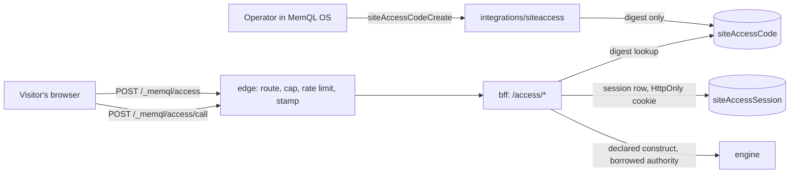

# Deployable access codes

Owner brief, 2026-10-29. A deployable can be public, or it can be gated as a
whole by nothing at all: the edge answers any host it can resolve to a live site
(`component/edge/doc.go`). Products that need part of a site to open only for a
named person have had to work around that from the browser, which cannot revoke
a code, audit its use or hold an expiry. The
owner wants the proper mechanism in the platform, managed from the Deployables
app, generic enough for any deployable.

**Approvals.** The owner approved this design on 2026-10-29 ("I approve of all of
this, get it done"), including a new HTTP surface under the gRPC-first policy
(section 6). The forks the owner did not settle personally are decided in
section 3 with the secure default, and each is named so it can be overruled.

## 1. What the owner asked for

| # | Requirement, in the owner's terms |
| --- | --- |
| R1 | Managed in MemQL OS: open Deployables, select a deployable, and beside the options already there (open the site, logs, traffic) there is an Access codes option with a lock. |
| R2 | A deployable has one or more codes. The front end connects each code to its own gates and UI. The model is a public site where a client opens their engagement, enters their code and sees their details, so there is one code per client. |
| R3 | A code is randomly generated. |
| R4 | To revoke, click a button to regenerate it. That gets rid of the previous one. |
| R5 | A code has an expiration, and it is real time: if a code expires after 10 minutes while someone is navigating, the moment the 10 minutes pass they are taken out. |
| R6 | Totally secure. The code is checked by the backend, not the browser. |
| R7 | Agnostic and generic. Moving any product onto it is that product's own work; the first user is a demo deployable on the owner's instance. |

## 2. Shape of the solution

Three existing patterns already answer most of this, so the design composes them
rather than adding a kind of identity:

- **Preview grants** (`v1:platform:sitePreviewGrant`,
  `component/memql/site_preview_token.go`, `integrations/sitepreview`) show how a
  deployable mints a random bearer credential: an authorized operator asks, the
  plain value comes back once, only a SHA-256 digest is stored.
- **The shopper surface** (`component/edge/shopper.go`,
  `component/server/shopper_handler.go`) shows how somebody who is nobody to
  MemQL reaches declared constructs on a site's own origin: the edge routes, caps
  and stamps; the bff re-reads the site, stamps reserved arguments last and runs
  the construct under the site owner's borrowed authority, never internal origin.
- **`@shopperFormExtension`** (`component/memql/shopper_extension_load.go`) shows
  how a product's DSL attaches to an engine-owned route at load time, with faults
  landing on the LoadReport so strict boot refuses them.



### Why a visitor's session is not a MemQL credential

`app/auth_mode_edge.go` records an owner-approved decision: the edge is not an
auth boundary, and "a hosted site's visitor carries no MemQL credential and never
will". This design keeps both halves. The edge makes no access decision; it
routes, caps, rate-limits and stamps, as it does for shopper forms, and the bff
authenticates for itself. An access session authenticates nobody to MemQL: no
JWT, no actor, no stream, no reach to any other route. It is honored by exactly
one handler, for one site.

### Why this is not the DSL-declared public form the shopper record rejected

`shopper_extension.go` rejects letting a DSL domain declare a form, because
"declaring a form puts an endpoint on a hosted site's own origin that anybody on
the internet may post to", which would widen who can open an endpoint from "Go
compiled into the engine" to "anyone who can author DSL". The same objection does
not reach `@accessGate`, for two reasons. DSL opens no endpoint: there is one
engine-owned route family and an annotation only says which construct a gate
reaches. And the population reaching it is not the internet: nothing runs without
a live session, which needs a code minted by an operator holding
`app:deployables/access`. The annotation gives a code something to open; it never
creates reach on its own. A deployable with no codes answers every call the same
way it answers a stranger.

## 3. Decisions

| # | Decision | Why |
| --- | --- | --- |
| D1 | Codes are random, shown once, stored only as a SHA-256 digest. A lost code is regenerated, never recovered. | A row read, a backup or a log line must not hand anybody a working code. Same reasoning as every other token family; unsalted SHA-256 is right because the input has 125 bits of entropy. |
| D2 | Format is 25 Crockford base32 symbols in five groups (`K7Q4M-2XPDN-8RT3V-WJ6HC-9FBZA`), 125 bits. Input is normalized before hashing: uppercased, `O`→`0`, `I`/`L`→`1`, and every other character outside the alphabet dropped, including the en dashes and zero-width characters email clients introduce. The last 4 symbols are stored as a hint. | People read these aloud, paste them from email and retype them. A wrong-looking character must not read as a wrong code. |
| D3 | A code opens exactly one gate, optionally with a subject. | "The front end connects codes to its gates." The gate says which part of the app; the subject says whose, which is what one-code-per-client needs without a code knowing about clients. |
| D4 | Reach is deny by default and declared per construct: `@accessGate(deployable="...", gate="...")`. | No credential in MemQL can be limited to named operations today (`auth.ScopeAllows` has no production caller), so the check lives where the call is built. |
| D5 | A gate names its deployable and records the DSL domain that declared it. Package analysis refuses a gate naming a deployable outside that package's manifest. At run time the bff requires the construct's `deployable` to equal the site's `packageDeployableName` and its domain to be one the site's package ships, recorded as `package.dslDomains`; an empty list refuses. | Gate and deployable names are short and will collide. DSL is already cluster-wide authority, so this is not a defense against a hostile author; it stops one product's code reaching another product's operations by accident, and stops a colliding name closing somebody else's gate. Automated security review, 2026-10-29. |
| D6 | A construct runs under the site owner's borrowed authority (`auth.ContextWithUserActor`), never internal origin. A site with no owner cannot have codes. | The shopper precedent: the owner owns what is written through their site. Internal origin would put every `@serverOnly` construct in reach. |
| D7 | Regenerate keeps the code's id, label, gate and subject, and replaces the secret. | Rows a product stamped with `accessCodeId` stay attached across a rotation, and the operator does not have to reconfigure anything. |
| D8 | Every code expires. Presets are 10 minutes, 1 hour, 1 day, 7 days and 30 days, plus a custom date, capped at 366 days. Expiry can be changed later without changing the code. | The honest bound on a bearer credential is its lifetime, so "never" is not offered. A long engagement picks a far date. |
| D9 | Removing a code is a soft end (`revokedAt`). The row stays as the record; the OS hides it. | Same as a preview grant: the row answers "who could get in, and when" after the fact. |
| D10 | A session ends at the earlier of the code's expiry and 24 hours after it opened. | A long-lived code should not produce an unending session on a machine somebody walked away from. Re-entering a code once a day is a small cost. |
| D13 | Nothing but an operator act writes a code's row: no heartbeat. "Last opened" is the newest `siteAccessSession` of the code's current generation. The row carries the version fence, so two writes racing cannot silently undo one. | A read-merge heartbeat re-stored the old digest during a regenerate in review, measured at 65 of 200 worst-case rounds, and the old code worked again, which makes R4 false. Removing the writer removes the race and the version growth. |
| D14 | Both concepts are readable only by internal origin or the cluster acting (a synthetic actor), and written only by the server (`@serverWritten`). Borrowed authority is not an exit, because a visitor's gated call runs under it. Every client path is a builtin passing the capability and organization gates. | A raw read otherwise passes neither gate, and returned another organization's labels in review. No working credential was exposed, but the owner asked for totally secure and one clause closes it. |
| D15 | A site's organization cannot change while it has live codes; the refusal says to remove them first. Act-on-code handlers re-read the code's site under the caller, and the bff refuses a code whose copied account differs from its site's current one, so a move racing a mint leaves a code that opens nothing. | Codes copy the site's `accountId` for the tier and the gate, so a move would leave the old organization able to mint for a site it can no longer read. |
| D11 | Validity is decided from the database on every request. Nothing in the access decision is cached: `v1:platform:siteAccess` joins `cacheDenylistedConceptPrefixes`, and the server reads carry `@cache(0)`. | Requirement R5. The edge's 15-second preview cache, or the engine's default result cache, would make "the moment the 10 minutes pass" false. |
| D12 | The first version gates what the bff returns, not the static bundle. | The first user needs only this, and a bundle is public by construction. Path gating at the edge is the follow-up binary assets will need; see section 14. |

## 4. Data

Both concepts live in `dsl/platform/concepts.memql`.

**`siteAccessCode`**, `@rowAuthz(owner="ownerUserId", clusterOwner, account="accountId")`,
the same composite tier as its site, so whoever manages a deployable sees all its
codes.

| Field | Meaning |
| --- | --- |
| `siteId` | Parent `v1:platform:site`. |
| `ownerUserId` | Copied from the site at mint time, never from the actor. |
| `accountId` | Copied from the site at mint time. |
| `label` | The operator's name for it ("Client reviewers"). Never sent to a visitor. |
| `gate` | Which gate it opens. |
| `subject` | Optional scope, stamped as `accessSubject`. |
| `codeHash` | SHA-256 hex of the normalized code. Excluded from the OS-facing shape. |
| `codeHint` | Last 4 symbols, so an operator can tell codes apart. |
| `generation` | Starts at 1, incremented by regenerate. |
| `issuedAt` | When this generation was minted. |
| `expiresAt` | Required. Compared against the engine's clock at request time, with no grace. |
| `revokedAt` | Soft end. |
| `lastChangedBy` | The `v1:identity:user` behind the latest operator act. |

**`siteAccessSession`**, `@rowAuthz(owner="ownerUserId", clusterOwner)` and
`@retention(ttl="30d", keepLatest=false, archive="none")`, one row per successful unlock. Fields: `siteId`, `codeId`,
`generation`, `ownerUserId`, `tokenHash` (SHA-256 of the plain `mql_acs_<43>`
cookie value), `issuedAt`, `endedAt`. A failed attempt writes nothing.

## 5. Operator surface

**DSL.** All in `dsl/platform`:

| Construct | Purpose |
| --- | --- |
| `builtin siteAccessCodeCreate(siteId, label, gate, subject?, expiresAt)` | Mints. Returns `{codeId, code, expiresAt}`; `code` appears nowhere else, ever. |
| `builtin siteAccessCodeRegenerate(codeId, expiresAt?)` | Replaces the secret, increments `generation`, keeps expiry unless a new one is given. Same reply shape. |
| `builtin siteAccessCodeSetExpiry(codeId, expiresAt)` | Takes effect on the next request. Extending an expired code revives that code. |
| `builtin siteAccessCodeRemove(codeId)` | Soft end. A builtin rather than a plain mutation so it reaches the audit log like the other three. |
| `builtin siteAccessCodesForSite(siteId)` | Every code, without `codeHash`, each with `lastOpenedAt` from its newest session of the current generation. The OS hides removed ones. A builtin because the shared organization gate judges builtins and mutations and never a query. |
| `builtin siteAccessGates(siteId)` | The gates declared for this deployable: `{gate, usesSubject, constructs[]}`. |

Executors are `integration.siteAccess.*` in a new `integrations/siteaccess`,
modeled on `integrations/sitepreview`: every gate runs before anything is minted,
site and code reads run under the caller so they are authorization rather than
lookup, and the writes use `auth.ContextWithInternalOrigin` against `@serverOnly`
mutations. A create runs under the site owner's actor, so a new row's owner is the
site's. Every later lookup and update runs as the cluster acting, because a row's
stamped owner must not decide whether a code can still be found or ended once the
person or the site has moved on; for the same reason both concepts stay out of
ownership transfer. A code is never minted inside a run, whose journal is durable and
cluster-readable. The package joins the allowlist in
`call_origin_conformance_test.go`.

**Authority.** `@requiresCapability("execute", "app:deployables/access")`, a new
part seeded on owner and developer in `dsl/rbac/seeds.memql`, matching
`deploy`, `publish` and `preview`. `component/memql/organization_action_capabilities.go`
gets the part and the targets (`siteAccessCodeCreate`, `siteAccessCodesForSite` and
`siteAccessGates` on the site, the others on the code), so the shared gate checks the selected organization
as it does for `sitePreviewOpen`. Refused at mint: a site with no owner, a system-owned site,
a site with no package deployable, a gate not declared for this deployable, a
label outside 1 to 80 characters, a subject over 120 characters, an expiry under 1
minute or over 366 days away. A regenerate or a new expiry on a site that has since
lost its owner is refused too, since such a code opens nothing; only removal stays
allowed there. An act needs a person: a synthetic actor and the operator credential
are refused.

**Audit.** Create, regenerate, set expiry and remove each write
`v1:identity:auditEvent` with `targetType: siteAccessCode`, as `integrations/rbac`
does for grants. The code itself is never in the event.

**MemQL OS.** Per `clients/os/DESIGN.md` and Supervised Visual Composition:

- A quiet `IconButton` labelled "Access codes" with the lucide `Lock` icon in the
  deployable page's head, after Traffic. It is absent, not disabled, without the
  part, on a system-owned site, or on a site with no package deployable.
- It opens a `DetailDialog` holding a `Subhead` with an icon-only `AddButton`, and
  a `RecordList`. Each row shows the label, what it unlocks, the code's hint, the
  expiry ("Expires in 8 minutes", exact time behind it, "Expired" once past) and
  "Last opened 2 minutes ago" or "Not opened yet". The list is in label order. Status is never colour alone.
- Row actions are `IconButton`s: Regenerate, Change expiry, and Remove (borderless
  trash). Regenerate and Remove confirm in place with `InPlaceAsk`, saying what
  stops working: "The current code stops working and anyone using it is taken out
  now." Illegal acts are absent.
- Add is a short form: Name, Unlocks (a `Select` of the deployable's gates,
  preselected when there is one), a subject field only when the chosen gate's
  constructs use `accessSubject`, and Expires (the presets, with a `DateTimeInput`
  behind Custom whose label names the time zone).
- After create or regenerate the code appears once: `Notice tone="warn"` saying
  this is the only time it is shown, `CopyValue`, and Done. It is held in component
  state only and dropped on the next act.
- With no gates declared the panel explains that an app opens a gate with
  `@accessGate`, and the Add control is absent. A failed read never looks empty,
  and loading is a skeleton.

Grant and code rows do not broadcast, so the panel reads through `useReading` and
re-reads after each write, as `usePreview.ts` does.

## 6. Visitor protocol

**Owner-approved HTTP exception, 2026-10-29.** A visitor's browser has no MemQL
identity to open a stream with, and only an HTTP response can set an `HttpOnly`
cookie, so the other party dictates the wire. It is one route family on the
deployable's own origin, with four operations:

| On the site's origin | bff route | Reply |
| --- | --- | --- |
| `POST /_memql/access`, body `{"code":"..."}` | `POST /access/unlock` | `200 {"gate","subject","expiresAt","remainingMs"}` plus the cookie. `401 {"state":"invalid"}`. `403 {"state":"expired"}`. `429` with `Retry-After`. |
| `GET /_memql/access` | `GET /access/session` | `200` as above, `401 {"state":"none"}` with no `Set-Cookie`, or `401 {"state":"ended"}`, clearing the cookie. |
| `POST /_memql/access/leave` | `POST /access/leave` | `204`, ends the session and clears the cookie. Idempotent. |
| `POST /_memql/access/call`, body `{"call":"name","args":{...}}` | `POST /access/call` | `200 {"data":[...]}`. `401 {"state":"ended"}`. `404` for anything the session's gate does not reach. `400 {"error":"invalid_args"}`. `502 {"error":"refused"}`. |

**The cookie.** `__Host-memql_access=mql_acs_<43>; Path=/; HttpOnly; Secure;
SameSite=Strict`, no `Domain`, no `Max-Age`: the server is the authority on expiry,
and an extension must not be cut short by a browser-side clock. A browser refuses a
`__Host-` cookie from a sibling site, or with any other path, so another organization's
deployable on `*.memql.<domain>` cannot plant one. Measured in Chromium with the
earlier `memql_access` and `Path=/_memql/access`: a sibling's `document.cookie`, with a
longer path, was sent first and read first, the handler answered `ended` and deleted the
real cookie while the planted one survived, and a planted live session would have caught
the visitor's gated writes. `none` sets nothing, because a cross-site navigation to `GET
/_memql/access` arrives with no cookie under `SameSite=Strict`, and a clear in that reply
deleted the real cookie. Only `ended` and `leave` clear it.

**The price of `Path=/`** is that a browser sends the cookie with every request to the
site, so the edge keeps it to the surface: every other way a request leaves the edge for
an upstream, the generic proxy, the shopper surface and the identity proxy, removes it
from the `Cookie` header and leaves the rest of that header as it was.

**The edge** (`component/edge/access.go`, routed in `serveResolved` before the
generic `/_memql/*` proxy and independent of `apiProxy`, as forms are):

- Refuses anything but the four method and path pairs, and sites with no owner.
- On POST, requires `Content-Type: application/json`, and refuses an `Origin` whose
  host is not the request's host.
- Caps the body: 1 KiB for unlock and leave, 64 KiB for call. The inbound path and both
  caps are `component/memql`'s, read by the edge and the bff.
- Rate-limits per replica: unlock at 10 per minute per (site, address) and 60 per
  minute per site, everything else at 600 per minute per (site, address). The
  address is the right-most `X-Forwarded-For`, the hop the ingress recorded, because
  a client can set the leftmost, and rotating it would spend the site's bucket and
  lock real visitors out of unlock. An IPv6 address keys on its /64, because one
  connection is routinely handed a whole /64, so a shared /64 shares a bucket. A proxy
  added in front of the ingress would group the visitors behind it into one bucket.
  These bound load, not guessing; 125 bits is what stops guessing.
- Strips then sets `X-Memql-Access-Site` and `X-Memql-Access-Owner`, and forwards to
  `MEMQL_EDGE_API_TARGET`. The stamp is a pointer: the bff reads the site's row as the
  cluster and requires its `ownerUserId` to equal the stamp.
- Forwards the access cookie and no other credential: `Authorization` and every other
  cookie, `memql_auth` included, are dropped on these four routes, because the bff never
  reads them. Left on, they were a read a visitor could drive, through the session
  revocation middleware, and a plain-text `401` for a browser with a revoked sign-in.
- Every reply carries `Cache-Control: no-store` and `X-Content-Type-Options: nosniff`.

**The bff** (`component/server/access_handler.go`, mounted by
`app/transport_access_surface.go`, declared through `AccessSurfacePaths()`,
classified in `HandlerAuthorizedPaths()` and `servedButNotExternallyRouted`, so the
edge is the only way in). `component/server` may not stamp internal origin, so its
rows are read and written through an interface that `integrations/siteaccess`
implements, and every read of a site, a package, a code or a session runs as the
cluster acting and a session is created under the site's owner, so the handler's own
comparison of the edge's owner stamp with the site row is the check on the owner.

**The order is what a stranger costs.** Anybody on the internet can send these requests,
and the budget is 600 a minute per (site, address) on each edge replica. Measured with the
site resolved first and under the owner's authority: a cookie-less `GET` ran 52 statements,
38 of them reads of `v1:identity:user`, and a pool of 4 connections flattened at about 50
requests a second. So:

- **Missing stamps:** the one `404`, with no read.
- **No cookie:** no read. `GET` answers `401 none`, a call `401 ended`, a leave `204`.
- **A cookie that could not be a token** (not `mql_acs_` and 43 base64url characters) is a
  miss, with no read.
- **The session by its digest, through an index.** A miss, an ended session and another
  site's session are `ended`, with no site read.
- **Unlock:** a body that could not hold a code (25 symbols once normalized) is `invalid`,
  with no read. Otherwise normalize, hash, and look up by `(siteId, codeHash)`, through an
  index. No row is `invalid`, with no site read and no other write.
- **Only after a digest hit,** read the site as the cluster, one point read, and compare the
  stamp with its owner. A stamp that does not check out is the one `404`, with a `WARN`.
  Each read is the row and its latest-version check, two statements: the store marks them
  to expand no relationships, which the engine otherwise does for every read.

**Unlock**, past that: a revoked row or another site's row is the same `invalid`, so the
reply is no oracle. A matching row past its expiry is `expired`, which only somebody
holding the exact code can learn. Otherwise mint a token, write the session row, set the
cookie.

**Every other request**, past that: read the session's code and require session not
ended, `session.generation == code.generation`, code not revoked, the code's copy of the
account equal to the site's, and now before the earlier of `code.expiresAt` and
`session.issuedAt + 24h`. Any failure is `ended` and clears the cookie.

- **Call:** a query answers with its shape's rows and bare ids. A mutation has no shape
  clause, so it answers with only the row's bare id. Read the package's domains as the
  cluster and resolve `call` in the gate registry for this site's deployable and the
  session's gate. Unknown, undeclared, wrong gate and wrong deployable are all the same
  `404`, so a code holder cannot enumerate another gate. See section 7. **Just before the
  construct runs, read the site and its package again under the owner's borrowed
  authority**, and answer the identical `404` with a `WARN` if the owner cannot read them.
  That read is what closes a tied site whose owner left its organization, and a call already
  pays for that authority. Unlock, the status check and leave do not make it, so such a site
  still unlocks and its calls answer `404`.
- Never logs a code, a token or call arguments.

## 7. `@accessGate`

```memql
@accessGate(deployable="client-desk", gate="dashboard")
@actor
@cache(0)
query deskBrief deskBriefs {
  args { accessCodeId string! }
  filter row => row.ownerUserId == actor.userId && row.accessCodeId == args.accessCodeId
  paginate 20
  shape deskBriefFull
}
```

**Reserved arguments.** `siteId`, `accessCodeId`, `accessGate` and `accessSubject`
are stamped by the handler, last, when the construct declares them. A caller
sending one is refused with `invalid_args`. This is how a product isolates data
between codes: rows carry the stamped `accessCodeId` or match `accessSubject`, and
the filter says so. A gated construct that reads rows with neither is opening
them to everyone holding any code for that gate, which the author is deciding
deliberately by writing the annotation.

**Load rules**, in `component/memql/access_gate_load.go`, faults landing on the
LoadReport so strict boot refuses them and package analysis reports
`dsl_refuses_boot` before a deploy:

- Legal on a `query` or `mutation` only, and written at most once on a construct.
- `deployable` matches `^[a-z0-9][a-z0-9-]{0,62}$`, `gate` matches `^[a-z][a-z0-9-]{0,39}$`.
- Refused alongside `@serverOnly`, which contradicts it, and alongside
  `@requiresRank` or `@requiresCapability`: a borrowed writer-role stand-in would
  make those mean something the author did not intend.
- A reserved argument, when declared, must be `string`.
- Two gated constructs with one name, under one deployable, in one DSL domain are refused. The same name in another domain is not a fault: its site's package does not ship the first, so neither can close the other.

The registry is rebuilt on every load, so a domain dropped from a bundle stops
opening anything on the next boot.

**Binding to the package.** `AnalyzePackageDSL` reports the gates it loaded. Analysis
refuses one naming a deployable the manifest does not declare, as
`dsl_access_gate_foreign_deployable`, and one bound to a domain the package does not
ship, as `dsl_access_gate_foreign_domain`, before anything is staged. A deploy that publishes a
serving version records its domains on `package.dslDomains` once it has committed,
before the sites publish, so a refused, parked, cancelled or candidate-only run
leaves the list alone. No client write can name the field. They come
from the concept ids the load produced, so a pin with no concepts contributes
nothing. A rollback restores the list of the deployment it returns to. The bff reads
that list on every gated call, as the cluster and then under the site's owner.

**Building the call.** Only names declared by the construct may appear, because
`dslCall` writes argument names as raw text and JSON-encodes only the values. A
key that is not a declared non-reserved argument is `invalid_args` before anything
is rendered. The construct name comes from the registry, never from the request.
Results go through `memql.MaterializeRows`.

**Where it resolves.** The edge forwards to `bff-http`, which selects the neutral
`bff`. That node mounts product DSL (`dsl-bundle-copy`, `dsl-packages-fetch`),
verified on production on 2026-10-29, and `deploy/k8s/instance` records the same
route for shopper form extensions.

## 8. Ending in real time

R5 is met by three independent mechanisms, so no single one has to be perfect:

1. **The server refuses.** Validity is read from the database on every request
   (D11), compared with the engine's clock, with no grace and no leeway. After the
   instant of expiry, no gated data leaves the bff, whatever the browser does.
2. **The browser leaves on time.** Replies carry `remainingMs`, not just
   `expiresAt`, so a wrong client clock does not move the moment. The client
   schedules the end from `remainingMs` and drops gated state the instant it fires.
3. **The browser learns of an operator's act.** Regenerate, remove and a shortened
   expiry reach an open tab through `GET /_memql/access`, polled every 5 seconds
   while the page is visible and at once on `visibilitychange`, `focus` and
   `online`, and through a `401` on any call. A changed `remainingMs` reschedules
   the timer.

**Stated plainly:** expiry is exact to the timer. An operator's act reaches a tab
that is sitting idle within 5 seconds, and it is refused at the server immediately.
The server has no way to push to a browser today (`MemqlServerMessage` has no such
payload and a visitor has no stream), and a push channel is not worth building for
the difference. A hidden tab's timer may be throttled by the browser; it re-checks
the moment it becomes visible, and the server has already stopped answering it.

The client half is a small obligation documented in
`docs/public/operate/site-access-codes.md`. It is not in the SDK in this version:
it is a few dozen lines over `fetch`, and it moves to the SDK when a second client
needs it.

## 9. Threats

| Threat | Answer |
| --- | --- |
| Guessing a code | 125 bits. Rate limits bound load. Failures write nothing, are one indistinguishable reply, and cost one lookup by digest through an index. |
| A stranger running up the database | No cookie, a malformed token and a body that holds no code cost no read. Nothing but a digest that found a row reads the site. |
| A leaked row, backup or log | Digests only. Codes and tokens are never logged or put in audit events. |
| A stolen cookie | `HttpOnly`, `Secure`, `SameSite=Strict`, no `Domain`. Good only until expiry, regeneration, 24 hours or leave. The edge removes it from everything it forwards but the four routes, so it reaches no other service. |
| A sibling site planting a cookie | Every deployable on `*.memql.<domain>` shares a parent domain whoever owns it. A browser refuses a `__Host-` cookie from a sibling, so it cannot hide the real one, end it, or catch the visitor's writes with a session of its own. |
| A cross-site navigation to the status check | Arrives with no cookie under `SameSite=Strict`, answers `none`, and sets nothing, so it deletes nothing. |
| Cross-site request forgery | `SameSite=Strict`, JSON-only POST, and the `Origin` check. |
| XSS on the deployable | Cannot read the cookie. Can call declared constructs while the page is open, which is the reach the code already grants. The edge's hash-based CSP applies. |
| One product's code reaching another's operations | D5: the deployable name, the declaring domain against the site's package, and the session bound to one site. |
| Forged reserved arguments | Refused from the caller and stamped last. |
| Forged edge headers | Stripped by the edge; the bff path is not externally routed; the bff compares the stamped owner with the site's own. |
| A visitor's browser state driving the bff | The edge forwards the access cookie and no other credential, so a sign-in cookie or bearer costs no read and locks nobody out. |
| Injection through the call | Names allow-listed from the declaration; values JSON-encoded; construct name from the registry. |
| Reaching `@serverOnly` constructs | Never internal origin; refused at load. |
| Enumerating gates and constructs | One `404` for all of them; a stranger's `GET` learns `none`. |
| Session fixation | A fresh token on every unlock; a cookie with no row is `ended`. |
| A concurrent write undoing a revocation | D13: no heartbeat on the credential, and the version fence on its row, so an operator's act fails loudly rather than being lost. |
| Reading a code's row around the builtins | D14: raw reads, `parentOf`, `asOf` and subscriptions are refused for both concepts, and neither publishes graph events, so no automation or rule can journal one. |
| A site moved to another organization | D15: refused while it has live codes. |
| Visitor input in a generated prompt | The product's concern. A gated construct's arguments are untrusted input, and the docs say so. |
| Gated content in a public bundle | Not protected, by D12. Docs state that a bundle must hold nothing secret. |

**Known limitation.** Borrowed authority does not re-check that the site's owner is
still active, which is equally true of the shopper surface. Removing the codes is
how an operator ends access.

## 10. Observability

`memql_site_access_requests_total{op,result}` counts the four operations with no
per-attempt rows. The newest session answers "has anybody opened this", with no
write to the credential. Operator acts are in the audit log. Warnings name the site and construct,
never arguments.

## 11. Testing

**Go.**

- Mint and normalization: entropy, grouping, the `O`/`I`/`L` mappings, whitespace.
- Mint rules: each refusal in section 5, including capability and organization.
- Unlock: valid, unknown, other site's, revoked, expired, and a superseded code
  after regeneration.
- Session: expiry to the instant, the 24-hour cap, regeneration, removal, leave, a
  cookie with no row, and a shortened or extended expiry.
- Call: declared, wrong gate, wrong deployable, unknown name, undeclared argument,
  each reserved argument forged, stamping applied, and a `@serverOnly` construct out
  of reach. Executed against a real engine under the db-gated tree, as
  `integrations/sitepreview` does.
- Load rules: every refusal in section 7, through strict boot.
- Edge: routing order, the four pairs and nothing else, header strip and set, caps,
  `Origin`, content type, both rate buckets, independence from `apiProxy`.
- Surface gates: `AssertUnauthenticatedSurfaceDeclared`, the front-door generator,
  `test/dslconformance`, and the OS part parity gate.

**OS.** Vitest with `T/harness.tsx`: the head control's presence by part and site
kind, list and empty and failed reads, the add form, shown-once and dropped on the
next act, each confirmation, focus return. Rendered review through the QA harness
in both modes, empty and populated, plus a narrow capture, using fixtures.

**End to end.** The acceptance is on a running cluster: mint, unlock, call, watch a
10-minute code end a browser at the minute, regenerate and watch an open tab leave.

## 12. Documentation

New `docs/public/operate/site-access-codes.md`: the wire protocol, the client's
obligations and the security model. Updated: `CLAUDE.md`'s Allowed HTTP Exceptions,
`docs/public/operate/site-hosting.md`, `docs/public/operate/deployables.md`, the
annotation's long doc, `docs/public/build/building-a-pack.md` and
`clients/os/README.md`.

## 13. Rollout

The product depends on the engine, in this order. A package using `@accessGate` on
an older engine is refused at analysis as `dsl_refuses_boot`, so the wrong order
fails safely rather than crash-looping a node.

1. This change lands on `main` through a release train and ships in an engine
   release, published through the native pipeline.
2. The instance pins that release.
3. The product ships its deployable and DSL, deployed through Deployables.
4. An operator mints a code in the OS and the acceptance in section 11 runs on
   production.

## 14. Not in this version

- **Path gating at the edge.** A site declaring that `/e/acme/**` needs gate
  `engagement` with subject `acme`, enforced on static bytes. A product's PDFs,
  videos and demos will need it. The session and cookie here already reach every
  path on the site's origin, so the design is what remains.
- A push channel to the browser, per-visitor identity, and a list of who is in now.
- A client helper in `sdk/ts` (section 8).
